# CẨM NANG TOÀN DIỆN: THIẾT KẾ ROBOT BẰNG OPENSCAD VÀ CHUYỂN ĐỔI SANG URDF / XACRO (ROS 2 & GAZEBO)

> **Tài liệu hướng dẫn chi tiết từ A-Z:**
> 1. Tổng quan, cách cài đặt và sử dụng phần mềm **OpenSCAD**.
> 2. Tra cứu toàn bộ cú pháp, hàm, module và chức năng chi tiết của **OpenSCAD** (Cơ khí, Vật liệu, Vi điều khiển, Plugin & 11 chế độ Hoạt ảnh).
> 3. Quy trình thiết kế và chế tạo mô hình **Robot (AMR/AGV/Manipulator)** chuẩn công nghiệp trong OpenSCAD.
> 4. Quy trình chuẩn hóa và chuyển đổi mô hình từ **OpenSCAD sang URDF/Xacro** (tách mesh `.stl`, đồng bộ gốc tọa độ `origin`, đa màu sắc, tính toán `collision` & `inertial`, cấu hình `joint` và chạy mô phỏng trong **RViz2 & Gazebo**).
>
> 💡 **Mẹo xem tài liệu hiển thị đầy đủ hình ảnh trong VS Code:** Mở file `README.md` (hoặc `read.me`) và nhấn tổ hợp phím **`Ctrl + Shift + V`** (hoặc bấm biểu tượng **Open Preview to the Side** ở góc trên bên phải cửa sổ VS Code).

| Mô hình Robot AMR lắp ráp hoàn chỉnh (`OpenSCAD`) | Bản vẽ phân rã giải phẫu cơ khí & điện tử (`Exploded View`) |
| :---: | :---: |
| 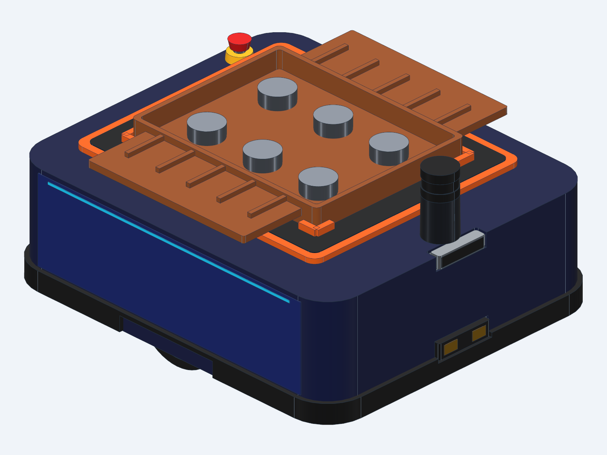 | 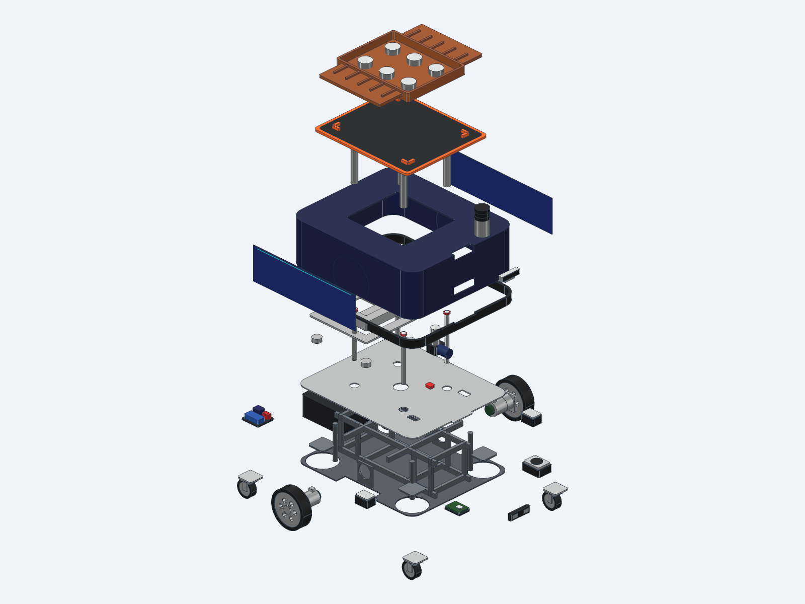 |

---

## MỤC LỤC

- [PHẦN 1: TỔNG QUAN & HƯỚNG DẪN SỬ DỤNG OPENSCAD](#phần-1-tổng-quan--hướng-dẫn-sử-dụng-openscad)
  - [1.1. OpenSCAD là gì? Tại sao dùng OpenSCAD để thiết kế Robot?](#11-openscad-là-gì-tại-sao-dùng-openscad-để-thiết-kế-robot)
  - [1.2. Cài đặt OpenSCAD](#12-cài-đặt-openscad)
  - [1.3. Giao diện làm việc và Hệ thống phím tắt](#13-giao-diện-làm-việc-và-hệ-thống-phím-tắt)
  - [1.4. Hệ trục tọa độ, Đơn vị và Biến độ mịn lưới ($fn, $fa, $fs)](#14-hệ-trục-tọa-độ-đơn-vị-và-biến-độ-mịn-lưới-fn-fa-fs)
  - [1.5. Các ký tự điều khiển hiển thị đặc biệt (Modifier Characters: *, !, #, %)](#15-các-ký-tự-điều-khiển-hiển-thị-đặc-biệt-modifier-characters----)
  - [1.6. Giải đáp chuyên sâu: Khả năng & Giới hạn của OpenSCAD (Cơ khí, Vật liệu, Vi điều khiển, Plugin & 11 Chế độ Animation)](#16-giải-đáp-chuyên-sâu-khả-năng--giới-hạn-của-openscad-cơ-khí-vật-liệu-vi-điều-khiển-plugin--11-chế-độ-animation)
- [PHẦN 2: CHI TIẾT TOÀN BỘ CHỨC NĂNG & CÚ PHÁP CỦA OPENSCAD](#phần-2-chi-tiết-toàn-bộ-chức-năng--cú-pháp-của-openscad)
  - [2.1. Nhóm hình khối 3D cơ bản (3D Primitives)](#21-nhóm-hình-khối-3d-cơ-bản-3d-primitives)
  - [2.2. Nhóm hình học 2D cơ bản (2D Primitives) & Văn bản (Text)](#22-nhóm-hình-học-2d-cơ-bản-2d-primitives--văn-bản-text)
  - [2.3. Quét 2D thành 3D (Extrusion) & Chiếu 3D xuống 2D (Projection)](#23-quét-2d-thành-3d-extrusion--chiếu-3d-xuống-2d-projection)
  - [2.4. Các phép biến đổi hình học (Transformations)](#24-các-phép-biến-đổi-hình-học-transformations)
  - [2.5. Các phép toán Boolean CSG (Constructive Solid Geometry)](#25-các-phép-toán-boolean-csg-constructive-solid-geometry)
  - [2.6. Các phép toán hình học nâng cao (hull, minkowski, offset)](#26-các-phép-toán-hình-học-nâng-cao-hull-minkowski-offset)
  - [2.7. Biến, Toán tử, Câu lệnh điều kiện và Vòng lặp](#27-biến-toán-tử-câu-lệnh-điều-kiện-và-vòng-lặp)
  - [2.8. Module và Function (Xây dựng thư viện tái sử dụng)](#28-module-và-function-xây-dựng-thư-viện-tái-sử-dụng)
  - [2.9. Quản lý đa file: Sự khác biệt giữa `include` và `use`](#29-quản-lý-đa-file-sự-khác-biệt-giữa-include-và-use)
  - [2.10. Nhập/Xuất file (Import/Export), Debug (`echo`, `assert`) và Hoạt ảnh (`$t`)](#210-nhậpxuất-file-importexport-debug-echo-assert-và-hoạt-ảnh-t)
- [PHẦN 3: CÁCH CHẾ TẠO ROBOT TRONG OPENSCAD CHI TIẾT TỪNG BƯỚC](#phần-3-cách-chế-tạo-robot-trong-openscad-chi-tiết-từng-bước)
  - [3.1. Bước 1: Quy ước Hệ trục tọa độ chuẩn ROS (REP-103)](#31-bước-1-quy-ước-hệ-trục-tọa-độ-chuẩn-ros-rep-103)
  - [3.2. Bước 2: Thiết kế Tham số hóa (Parametric Design) & Kiểm tra Ràng buộc](#32-bước-2-thiết-kế-tham-số-hóa-parametric-design--kiểm-tra-ràng-buộc)
  - [3.3. Bước 3: Phân rã Robot thành các Module theo Cây động học (Kinematic Tree)](#33-bước-3-phân-rã-robot-thành-các-module-theo-cây-động-học-kinematic-tree)
  - [3.4. Bước 4: Thiết kế chi tiết từng cụm cơ khí & cảm biến trong OpenSCAD](#34-bước-4-thiết-kế-chi-tiết-từng-cụm-cơ-khí--cảm-biến-trong-openscad)
  - [3.5. Bước 5: Lắp ráp tổng thể, Kiểm tra vùng quét cảm biến & Bản vẽ phân rã (Exploded View)](#35-bước-5-lắp-ráp-tổng-thể-kiểm-tra-vùng-quét-cảm-biến--bản-vẽ-phân-rã-exploded-view)
- [PHẦN 4: QUY TRÌNH CHUYỂN ĐỔI TỪ OPENSCAD SANG URDF / XACRO CHI TIẾT](#phần-4-quy-trình-chuyển-đổi-từ-openscad-sang-urdf--xacro-chi-tiết)
  - [4.1. Nguyên lý cốt lõi khi chuyển từ CAD sang URDF](#41-nguyên-lý-cốt-lõi-khi-chuyển-từ-cad-sang-urdf)
  - [4.2. QUY TẮC VÀNG: Dịch chuyển gốc tọa độ (Origin Alignment) khi xuất từng Link](#42-quy-tắc-vàng-dịch-chuyển-gốc-tọa-độ-origin-alignment-khi-xuất-từng-link)
  - [4.3. Kỹ thuật tạo Đa màu sắc (Multi-Color / Multi-Material) cho STL trong URDF](#43-kỹ-thuật-tạo-đa-màu-sắc-multi-color--multi-material-cho-stl-trong-urdf)
  - [4.4. Tự động hóa xuất hàng loạt Binary STL bằng Bash Script (`export_all_stl.sh`)](#44-tự-động-hóa-xuất-hàng-loạt-binary-stl-bằng-bash-script-export_all_stlsh)
  - [4.5. Quy đổi Đơn vị từ OpenSCAD (mm, deg) sang URDF (m, rad, kg)](#45-quy-đổi-đơn-vị-từ-openscad-mm-deg-sang-urdf-m-rad-kg)
  - [4.6. Thiết lập `<visual>`, `<collision>` tối ưu và công thức tính `<inertial>`](#46-thiết-lập-visual-collision-tối-ưu-và-công-thức-tính-inertial)
  - [4.7. Cấu hình các loại Khớp (`<joint>`): Fixed, Continuous, Revolute, Prismatic & Mimic](#47-cấu-hình-các-loại-khớp-joint-fixed-continuous-revolute-prismatic--mimic)
  - [4.8. Tích hợp Gazebo Physics (Ma sát, Động cơ vi sai, Bàn nâng, Cảm biến)](#48-tích-hợp-gazebo-physics-ma-sát-động-cơ-vi-sai-bàn-nâng-cảm-biến)
  - [4.9. Kiểm tra, Build và Chạy mô phỏng trong ROS 2 (RViz2 & Gazebo)](#49-kiểm-tra-build-và-chạy-mô-phỏng-trong-ros-2-rviz2--gazebo)


---

## PHẦN 1: TỔNG QUAN & HƯỚNG DẪN SỬ DỤNG OPENSCAD

### 1.1. OpenSCAD là gì? Tại sao dùng OpenSCAD để thiết kế Robot?

**OpenSCAD** (*"The Programmers Solid 3D CAD Modeller"*) là phần mềm thiết kế mô hình 3D rắn bằng **mã lệnh (script-based / programmatic CAD)** mã nguồn mở và miễn phí. Khác với các phần mềm CAD tương tác chuột truyền thống (như SolidWorks, Fusion 360, Inventor hay Blender), trong OpenSCAD bạn viết code mô tả hình học và phần mềm sẽ biên dịch đoạn code đó thành vật thể 3D theo phương pháp **CSG (Constructive Solid Geometry - Hình học khối xây dựng)**.

**Tại sao OpenSCAD đặc biệt mạnh mẽ khi chế tạo Robot và làm việc với ROS/URDF?**
1. **Tham số hóa tuyệt đối (100% Parametric):** Chỉ cần sửa 1 biến (ví dụ `drive_wheel_diameter = 220;` hoặc `robot_width = 580;`), toàn bộ khung gầm, trục bánh xe, vỏ máy, vị trí cảm biến sẽ tự động tính toán và co giãn khớp nhau.
2. **Đồng bộ toán học hoàn hảo với URDF/Xacro:** Mọi tọa độ đặt linh kiện trong OpenSCAD (`translate([x, y, z])`, `rotate([r, p, y])`) đều là các con số tường minh, có thể chuyển trực tiếp sang thẻ `<origin xyz="..." rpy="..."/>` của URDF mà không cần đo đạc thủ công dễ sai số.
3. **Quản lý phiên bản bằng Git dễ dàng:** File `.scad` là văn bản thuần túy (plain text), rất nhẹ, dễ dàng kiểm soát lịch sử thay đổi (`git diff`, `git merge`).
4. **Tự động hóa xuất hàng loạt qua dòng lệnh (CLI):** Có thể dùng script Bash/Python gọi OpenSCAD chạy ngầm để xuất hàng chục file `.stl` cho từng khớp robot chỉ bằng 1 lệnh duy nhất.

---

### 1.2. Cài đặt OpenSCAD

- **Trên Ubuntu / Debian Linux:**
  ```bash
  # Cài bản ổn định qua APT:
  sudo apt update && sudo apt install openscad

  # Hoặc cài bản Nightly qua Snap (hỗ trợ backend Manifold render nhanh gấp 10-100 lần):
  sudo snap install openscad-nightly
  ```
- **Trên Windows / macOS:** Tải bộ cài đặt tại trang chủ [https://openscad.org/downloads.html](https://openscad.org/downloads.html).
- **Quy trình làm việc kết hợp VS Code + OpenSCAD:**
  1. Mở file `.scad` bằng **VS Code** (cài thêm extension *OpenSCAD* để tô màu cú pháp).
  2. Mở cùng file đó trong **OpenSCAD**, vào menu **Design -> Automatic Reload and Preview** (đánh dấu tích).
  3. Ẩn trình soạn thảo mặc định của OpenSCAD (**View -> Hide Editor**) để dành toàn bộ màn hình cho khung nhìn 3D. Mỗi khi bạn bấm `Ctrl + S` bên VS Code, mô hình 3D bên OpenSCAD sẽ tự động cập nhật tức thì!

---

### 1.3. Giao diện làm việc và Hệ thống phím tắt

Giao diện OpenSCAD gồm 4 khu vực chính (như hình chụp thực tế bên dưới):
1. **Text Editor (Bên trái):** Nơi viết mã nguồn `.scad`, khai báo tham số và chọn chế độ hoạt ảnh (`animation_mode = 0..10`).
2. **3D Viewport (Ở giữa):** Màn hình hiển thị mô hình Robot 3D trực quan kèm hệ trục tọa độ gốc `X, Y, Z` và thước đo khoảng cách (mm).
3. **Thanh công cụ Animate / Console / Error Log (Phía dưới):** Điều khiển chạy hoạt ảnh thời gian thực (`Time`, `FPS`, `Steps`, nút Play/Pause) và hiển thị thông báo kiểm tra thiết kế `echo()`, `assert()`.
4. **Thanh công cụ Render & Góc nhìn (Phía trên & dưới Viewport):** Gồm các nút `Preview (F5)`, `Render (F6)`, `Export STL (F7)`, bật/tắt trục tọa độ và chuyển đổi nhanh các góc nhìn.


*Hình 1.0: Giao diện làm việc chính của OpenSCAD khi mở file `cad/main.scad`.*

#### Bảng phím tắt & thao tác chuột quan trọng nhất:

| Phím tắt / Thao tác | Chức năng | Giải thích chi tiết |
| :--- | :--- | :--- |
| **`F5`** | **Preview (Xem trước nhanh)** | Dùng thuật toán OpenCSG trên GPU để hiển thị cực nhanh mô hình (giữ nguyên màu sắc `color()`, hỗ trợ hoạt ảnh `$t`). Chưa tạo lưới đa giác thực sự. |
| **`F6`** | **Render (Kết xuất chính xác)** | Dùng thư viện hình học CGAL/Manifold trên CPU để tính toán chính xác lưới đa giác 3D (2-manifold mesh). **Bắt buộc phải bấm `F6` trước khi xuất file STL!** |
| **`F7`** | **Export as STL** | Xuất mô hình đã Render (`F6`) ra định dạng file `.stl`. |
| **`F12`** | **Thrown Together View** | Chế độ kiểm tra lỗi mặt đa giác (mặt bị lộn ngược pháp tuyến sẽ hiện màu tím hồng, phần bị cắt bởi `difference()` hiện màu xanh lá). |
| **`Ctrl + D` / `Ctrl + Shift + D`** | Comment / Uncomment | Đóng/mở ghi chú dòng code đang chọn. |
| **`Chuột trái + Kéo`** | Xoay góc nhìn (Orbit) | Xoay camera quanh tâm nhìn trong không gian 3D. |
| **`Chuột phải + Kéo`** | Dịch chuyển (Pan) | Trượt camera sang trái/phải/lên/xuống. |
| **`Con lăn chuột (Scroll)`** | Phóng to / Thu nhỏ (Zoom) | Phóng to hoặc thu nhỏ mô hình. |
| **`Ctrl + 4 / 5 / 6 / 7 / 8 / 9`** | Góc nhìn hình chiếu | Top (`Ctrl+4`), Bottom (`Ctrl+5`), Left (`Ctrl+6`), Right (`Ctrl+7`), Front (`Ctrl+8`), Back (`Ctrl+9`), Isometric (`Ctrl+1`). |
| **`Ctrl + P`** | Xem/Ẩn trục tọa độ (Axes) | Bật/tắt hệ trục tọa độ gốc X, Y, Z và thước đo trong 3D Viewport. |

---

### 1.4. Hệ trục tọa độ, Đơn vị và Biến độ mịn lưới (`$fn`, `$fa`, `$fs`)

1. **Hệ trục tọa độ:** OpenSCAD sử dụng **Hệ tọa độ Đề-các bàn tay phải (Right-handed Cartesian coordinate system)** giống hệt với ROS và URDF:
   - Trục **X** (màu Đỏ)
   - Trục **Y** (màu Xanh lá)
   - Trục **Z** (màu Xanh dương - hướng thẳng đứng lên trên)
2. **Đơn vị đo:** OpenSCAD mặc định không khóa đơn vị, nhưng **quy ước chuẩn toàn cầu khi xuất file STL là `1 đơn vị = 1 milimét (mm)`** và **góc xoay tính bằng `độ (degrees: 0 -> 360)`**.
3. **Các biến đặc biệt điều khiển độ mịn đường cong (`$fn`, `$fa`, `$fs`):**
   Trong đồ họa 3D, hình tròn/cầu/trụ được xấp xỉ từ các mặt phẳng đa giác:
   - `$fn` (*Fragment Number*): Số đoạn thẳng chia đều 1 đường tròn. Nếu `$fn = 0` (mặc định), OpenSCAD dùng `$fa` và `$fs`.
     - `$fn = 6`: Hình trụ `cylinder()` sẽ biến thành **lục giác đều** (rất tiện để vẽ đai ốc/đầu bulông M6, M8).
     - `$fn = 32`: Đủ mịn để xem trước (`Preview` `F5`) mà không gây giật lag.
     - `$fn = 72` hoặc `96`: Rất mịn, dùng khi kết xuất (`Render` `F6`) xuất file STL.
   - `$fa` (*Fragment Angle*): Góc tối thiểu của mỗi mảnh (mặc định `12` độ).
   - `$fs` (*Fragment Size*): Độ dài tối thiểu của mỗi mảnh (mặc định `2` mm).

   **Mẹo tối ưu tốc độ chuẩn công nghiệp (được dùng trong `cad/main.scad`):**
   ```openscad
   quality = "preview"; // Đổi thành "render" khi xuất STL
   preview_fn = 32;
   render_fn  = 72;
   $fn = (quality == "render") ? render_fn : preview_fn;
   ```

---

### 1.5. Các ký tự điều khiển hiển thị đặc biệt (Modifier Characters: `*`, `!`, `#`, `%`)

Khi thiết kế một robot phức tạp có hàng chục chi tiết lồng nhau, 4 ký tự tiền tố này đặt trước bất kỳ câu lệnh hoặc module nào sẽ giúp bạn debug cực nhanh:

| Ký tự | Tên gọi | Tác dụng trong quá trình thiết kế Robot | Ví dụ thực tế |
| :---: | :--- | :--- | :--- |
| **`*`** | **Disable (Vô hiệu hóa)** | Bỏ qua hoàn toàn câu lệnh/nhánh hình học đó (giống như comment nhưng áp dụng cho cả khối cây con). | `*body_shell();` (Tạm ẩn vỏ robot để nhìn bên trong). |
| **`!`** | **Show Only / Root (Chỉ hiện phần này)** | Ẩn toàn bộ phần còn lại của bản vẽ, **chỉ hiển thị duy nhất** đối tượng có dấu `!`. | `!drive_wheel(1, 0);` (Chỉ hiện riêng bánh xe trái để sửa mâm xe). |
| **`#`** | **Highlight / Debug (Đánh dấu đỏ mờ)** | Vẫn thực hiện phép tính hình học bình thường nhưng tô đối tượng đó thành **màu đỏ hồng bán trong suốt**. Cực kỳ hữu ích để kiểm tra vị trí lỗ khoan trong hàm `difference()`. | `difference() { cube(20); #cylinder(h=30, d=8); }` |
| **`%`** | **Transparent / Background (Làm mờ làm nền)** | Hiển thị đối tượng dưới dạng **màu xám trong suốt** và không tham gia vào phép tính hình học (không bị xuất ra STL). | `%body_shell();` (Làm vỏ robot trong suốt để ngắm pin, mạch điện bên trong). |

---

### 1.6. Giải đáp chuyên sâu: Khả năng & Giới hạn của OpenSCAD (Cơ khí, Vật liệu, Vi điều khiển, Plugin & 11 Chế độ Animation)

Khi thiết kế một hệ thống Robot tự hành phức tạp, bạn cần hiểu rõ **OpenSCAD làm được gì** và **những gì phải chuyển sang URDF / ROS 2 / Gazebo mới thực hiện được**. Bảng tổng hợp dưới đây giải đáp trực tiếp 5 câu hỏi cốt lõi:

| Tính năng / Yêu cầu kỹ thuật | OpenSCAD có làm được không? | Giải thích chi tiết & Cách phối hợp với URDF / Gazebo |
| :--- | :---: | :--- |
| **1. Mô tả chính xác hình thù cơ khí (Mechanical Geometry)** | **CÓ (Chính xác tuyệt đối)** | Dựng hình CSG chuẩn toán học đến từng phần trăm milimét (`0.01 mm`): khung gầm, mâm bánh xe CNC, cơ cấu nâng chữ X (Scissor Lift), gối bi trượt, vỏ máy, lỗ ốc M3/M6/M8. |
| **2. Mô tả Robot dùng vật liệu gì (Materials & Physics)** | **CHỈ MÀU SẮC (`color()`), KHÔNG CÓ VẬT LÝ** | OpenSCAD chỉ gán **màu sắc RGBA** để phân biệt thị giác (nhôm bạc, thép xám, cao su đen, đồng vàng, PCB xanh). Nó **không có** trọng lực, khối lượng riêng, độ bền hay hệ số ma sát. Khối lượng (`mass`), quán tính (`inertia`) và ma sát (`mu1`, `mu2`) phải khai báo bên **URDF/Gazebo**. |
| **3. Chạy Hoạt ảnh chuyển động (Animation)** | **CÓ (Động học theo kịch bản `$t`)** | Chạy mượt mà các kịch bản chuyển động theo biến thời gian `$t \in [0, 1]$ (chạy thẳng, xoay tại chỗ, nâng bàn nâng, xoay bánh caster, tháo lắp phân rã, lấy/trả hàng trên kệ). |
| **4. Dùng Vi điều khiển (ESP32-S3, Jetson, Arduino)** | **CHỈ VẼ HÌNH KHỐI 3D ĐỂ BỐ TRÍ LẮP ĐẶT** | Vẽ chính xác kích thước bo mạch ESP32-S3, Jetson SBC, BMS, Driver, IMU để kiểm tra không gian lắp đặt (Packaging) và lỗ bắt ốc. **Không nạp code C++/Python điều khiển vào OpenSCAD được** (code điều khiển chạy qua Node ROS 2). |
| **5. Dùng Plugin (Động cơ, Cảm biến LiDAR/Camera, Va chạm)** | **KHÔNG CÓ PLUGIN VẬT LÝ (Chỉ có Thư viện CAD)** | OpenSCAD không có plugin giải vật lý hay xuất tia laser thực. Vùng quét LiDAR/Camera trong OpenSCAD chỉ là khối hình học bán trong suốt để kiểm tra góc khuất. Các plugin điều khiển (`DiffDrive`, `JointPositionController`, `Sensors`) nằm trong **URDF/Gazebo**. |

---

#### 1.6.1. Mô tả chính xác hình thù cơ khí (Mechanical Geometry)

OpenSCAD mô tả hình học cơ khí bằng **phương trình toán học và tham số chính xác**, hoàn toàn đủ khả năng thiết kế từ chi tiết nhỏ nhất đến toàn bộ tổ hợp máy:
- **Kết cấu chịu lực & Vỏ máy:** Khung gầm 2 tầng (`chassis_bottom`, `chassis_top`), dầm dọc, dầm ngang, vỏ bảo vệ công nghiệp (`body_shell`), tấm nắp bảo trì tháo rời (`skin_panels`), dải đèn LED trạng thái (`status_lights`), cản chống va chạm (`bumper_skirt`).
- **Cụm truyền động & Cơ cấu chấp hành:** Bánh xe chủ động tách riêng lốp cao su và mâm nhôm CNC 6 chấu, động cơ BLDC + hộp số hành tinh + Encoder, 4 bánh xe tự lựa xoay 360° (`caster_assembly`), cơ cấu bàn nâng cắt kéo chữ X (`scissor_lift`) kèm xy-lanh điện và 4 trục dẫn hướng tuyến tính (`linear_bearing_sleeves`).


*Hình 1.1: Mô hình cơ khí 3D hoàn chỉnh của Robot Factory Delivery AMR được dựng 100% bằng code trong `cad/main.scad`.*


*Hình 1.2: Bản vẽ phân rã (Exploded View) cho thấy độ chi tiết cơ khí bên trong thân Robot: từ khung thép 2 tầng, cụm động cơ vi sai, 4 bánh caster, pin, mạch điện cho đến bàn nâng và khay tải 20 kg.*

---

#### 1.6.2. OpenSCAD có mô tả được Vật liệu (Materials) của Robot không?

- **Ở góc độ Thị giác (Visual Appearance) — CÓ:**
  Trong OpenSCAD, bạn dùng hàm `color([R, G, B, Alpha])` để đại diện trực quan cho từng loại vật liệu chế tạo:
  - **Hợp kim nhôm CNC (Aluminum 6061):** `color([0.78, 0.80, 0.84, 1.0])` (Mâm bánh xe, vỏ camera RealSense D455, trụ dẫn hướng).
  - **Thép kết cấu sơn tĩnh điện (Structural Steel):** `color([0.28, 0.30, 0.33, 1.0])` (Khung gầm chịu lực, quả nặng 20kg).
  - **Cao su Polyurethane (Elastomer / Rubber):** `color([0.14, 0.14, 0.16, 1.0])` (Lốp bánh xe chủ động, bánh caster, tấm lót chống trượt mặt bàn nâng).
  - **Đồng đỏ dẫn điện (Copper):** `color([0.88, 0.65, 0.18, 1.0])` (Bản cực tiếp điểm trạm sạc tự động).
  - **Sợi thủy tinh FR4 (PCB Board):** `color([0.15, 0.42, 0.25, 1.0])` (Bo mạch ESP32-S3, Smart BMS).
- **Ở góc độ Tính chất Vật lý (Physical Material Properties) — KHÔNG:**
  OpenSCAD không biết vật thể làm bằng sắt hay nhựa xốp, không tự tính được trọng lượng hay độ ma sát. Khi xuất sang file `.stl`, ngay cả màu sắc của `color()` cũng bị lược bỏ (vì chuẩn STL chỉ lưu lưới tam giác).
  $\Rightarrow$ **Cách xử lý chuẩn:** Tách các chi tiết khác vật liệu ra các file STL riêng (ví dụ `left_wheel_tire_visual.stl` và `left_wheel_hub_visual.stl`), sau đó gán lại màu sắc bằng thẻ `<material>` và khai báo khối lượng `<mass>`, quán tính `<inertia>`, hệ số ma sát `<mu1>`, `<mu2>` trong file **URDF/Xacro**!

---

#### 1.6.3. OpenSCAD có dùng được Vi điều khiển (ESP32-S3, Jetson) và Plugin không?

1. **Về Vi điều khiển & Linh kiện điện tử (`ESP32-S3`, `Jetson SBC`, `Smart BMS`, `Motor Driver`, `IMU`, `PDU`):**
   - Trong `cad/main.scad`, toàn bộ hệ thống điện tử được dựng thành các module 3D chuẩn kích thước thực: `esp32_s3_controller()`, `jetson_or_sbc()`, `bms()`, `power_distribution()`, `motor_driver()`, `imu_module()`.
   - **Mục đích:** Phục vụ **Thiết kế bố trí không gian cơ điện tử (Mechatronic Packaging & Clearance Check)** — kiểm tra xem các bo mạch đặt trong khoang bụng robot có bị cấn chạm với pin 48V-30Ah hay cơ cấu nâng hạ không, và xác định chính xác tọa độ gốc của cảm biến IMU/LiDAR/Camera để chuyển sang URDF.
   - **Giới hạn:** OpenSCAD chỉ vẽ hình học 3D của bo mạch, **không biên dịch hay chạy code C++/Python điều khiển**. Phần code điều khiển chạy trên các Node **ROS 2** (`amr_keyboard_teleop.py`, `lift_gazebo_controller.py`).
2. **Về Plugin và Thư viện mở rộng:**
   - OpenSCAD hỗ trợ nạp các **Thư viện CAD (`.scad` libraries)** như `MCAD`, `BOSL2`, `NopSCADlib` qua lệnh `use <...>` hoặc `include <...>` để vẽ nhanh ốc vít, bánh răng, vòng bi.
   - Các khối tia quét như `camera_fov_debug()` (hình chóp xanh ngọc trước mũi camera) hay `lidar_scan_debug()` trong OpenSCAD chỉ là **hình học bán trong suốt** giúp kiểm tra góc khuất cơ khí. Còn các **Plugin vật lý & cảm biến thời gian thực** (`DiffDrive`, `JointPositionController`, `JointStatePublisher`, `Sensors`) nằm trong thẻ `<gazebo><plugin .../></gazebo>` của file **URDF/Xacro**.

---

#### 1.6.4. Chức năng chạy Hoạt ảnh (Animation `$t`) & Toàn bộ 11 Chế độ Hoạt ảnh (`animation_mode = 0..10`) trong `cad/main.scad`

OpenSCAD tích hợp sẵn bộ tạo hoạt ảnh thời gian thực thông qua biến toàn cục **`$t`** (chạy tuần hoàn từ `0.0` đến `1.0`).
- **Cách kích hoạt trong OpenSCAD:** Vào menu **View $\rightarrow$ Animate**, thanh công cụ **Animate** sẽ hiện ra ở góc dưới bên phải. Bạn nhập **`FPS: 60`** và **`Steps: 100`** (hoặc `200`), sau đó thay đổi giá trị biến **`animation_mode`** (tại dòng `361` của `cad/main.scad`) từ `0` đến `10` để kiểm tra 11 kịch bản hoạt động của Robot:

| Giá trị `animation_mode` | Tên chế độ hoạt ảnh | Cơ cấu / Chức năng được kiểm chứng trong OpenSCAD |
| :---: | :--- | :--- |
| **`0`** | `Static model` | Mô hình tĩnh chuẩn tại gốc `(0, 0, 0)`, bàn nâng hạ thấp nhất (`lift_h = 0`). |
| **`1`** | `Drive straight forward` | Robot chạy thẳng dọc trục `+X`, 2 bánh chủ động quay đồng tốc, 4 bánh caster hướng về sau. |
| **`2`** | `Spin in place` | Robot tự xoay tròn $360^\circ$ tại chỗ quanh tâm `(0, 0)` trong hành lang hẹp `1200 mm`. |
| **`3`** | `Circular arc trajectory` | Robot di chuyển theo quỹ đạo cung tròn bán kính `R = 850 mm` (vi sai vận tốc 2 bánh). |
| **`4`** | `Lift table raise and lower` | Nâng/hạ bàn nâng chữ X (`Scissor Lift`) và xy-lanh điện hết hành trình `0 -> 290 mm`. |
| **`5`** | `Caster dynamic swivel demo` | Góc nhìn dưới gầm kiểm tra 4 bánh xe tự lựa (`Swivel Casters`) xoay cổ trục $360^\circ$ và lăn bánh. |
| **`6`** | `Approach and dock with charging station` | Tiến vào ghép nối chính xác 2 bản cực đồng với Trạm sạc tự động (`charging_station`). |
| **`7`** | `Complete factory delivery mission` | Chu trình hoàn chỉnh: Chạy đến điểm giao $\rightarrow$ Nâng/hạ bàn nâng trả hàng $\rightarrow$ Về trạm sạc. |
| **`8`** | `Exploded assembly animation` | Tự động tháo rời phân rã tuần tự toàn bộ linh kiện cơ khí & điện tử rồi lắp ráp lại. |
| **`9`** | `Smart two-level rack pickup mission` | Bật vùng nhìn Camera FOV, tiến vào kệ thông minh 2 tầng nâng/nhận khay hàng 20 kg mang đi. |
| **`10`** | `Smart two-level rack place mission` | Chở khay hàng 20 kg đến kệ thông minh 2 tầng, hạ bàn nâng đặt khay lên thanh đỡ rồi lùi ra. |

##### Chế độ 0 (`animation_mode = 0`): Mô hình tĩnh chuẩn (`Static model`)
Robot đứng yên tại gốc tọa độ `(0, 0, 0)`, mặt bàn nâng hạ thấp nhất, dùng để kiểm tra tổng thể kích thước và xuất file STL chuẩn.


##### Chế độ 1 (`animation_mode = 1`): Chạy thẳng về phía trước (`Drive straight forward`)
Robot di chuyển thẳng dọc theo trục `+X` (`Time = 0.52`), hai bánh xe chủ động trái/phải quay đồng tốc và 4 bánh caster tự lựa hướng thẳng về phía sau.
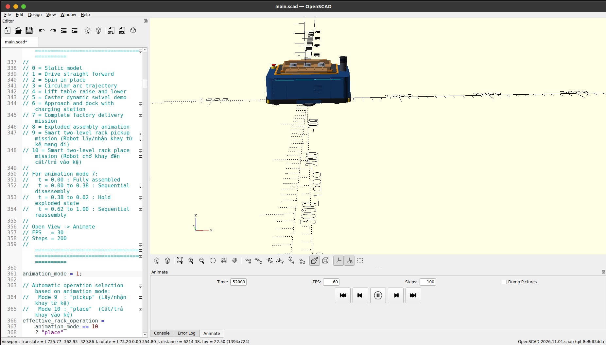

##### Chế độ 2 (`animation_mode = 2`): Xoay tròn tại chỗ (`Spin in place`)
Hai bánh xe chủ động quay ngược chiều nhau với cùng vận tốc góc (`left_wheel_angle = -right_wheel_angle`), giúp Robot tự xoay $360^\circ$ quanh tâm hình học `(0, 0)` mà không vượt ra ngoài hành lang hẹp `1200 mm`.
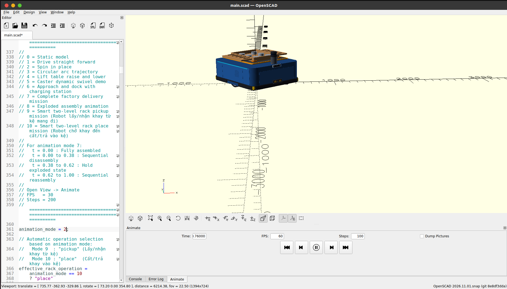

##### Chế độ 3 (`animation_mode = 3`): Chạy theo quỹ đạo cung tròn (`Circular arc trajectory`)
Mô phỏng động học vi sai khi bánh trái và bánh phải quay khác tốc độ, Robot lượn mượt theo cung tròn bán kính `R = 850 mm`.
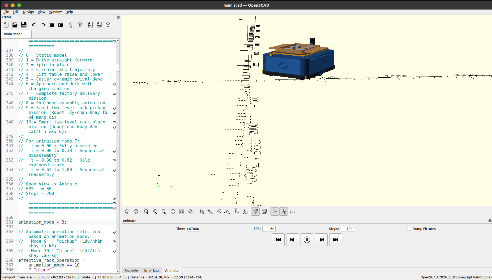

##### Chế độ 4 (`animation_mode = 4`): Nâng và hạ bàn nâng cắt kéo chữ X (`Lift table raise and lower`)
Kiểm tra động học cơ cấu bàn nâng chữ X (`Scissor Lift`): khi xy-lanh điện (`lift_actuator_ram`) đẩy lên, 4 thanh cắt kéo màu cam xoay đồng bộ đẩy mặt bàn nâng và khay tải 20 kg lên hết hành trình `290 mm`.
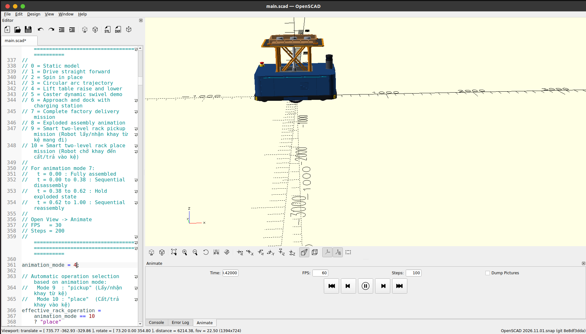

##### Chế độ 5 (`animation_mode = 5`): Mô phỏng động học xoay 4 bánh xe tự lựa (`Caster dynamic swivel demo`)
Góc nhìn từ dưới gầm xe lên cho thấy rõ cơ khí của 2 bánh chủ động ở giữa và 4 bánh xe tự lựa (`Swivel Casters`) ở 4 góc vừa xoay cổ trục $360^\circ$ quanh trục Z vừa lăn bánh quanh trục ngang tại các thời điểm khác nhau (`Time = 0.11` và `Time = 0.89`):

| Trạng thái góc xoay Caster tại `Time = 0.11000` | Trạng thái góc xoay Caster tại `Time = 0.89000` |
| :---: | :---: |
| 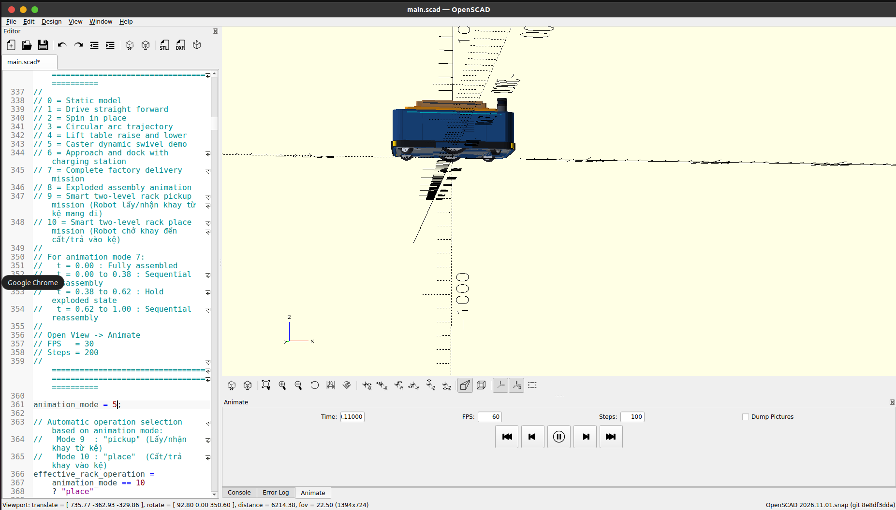 | 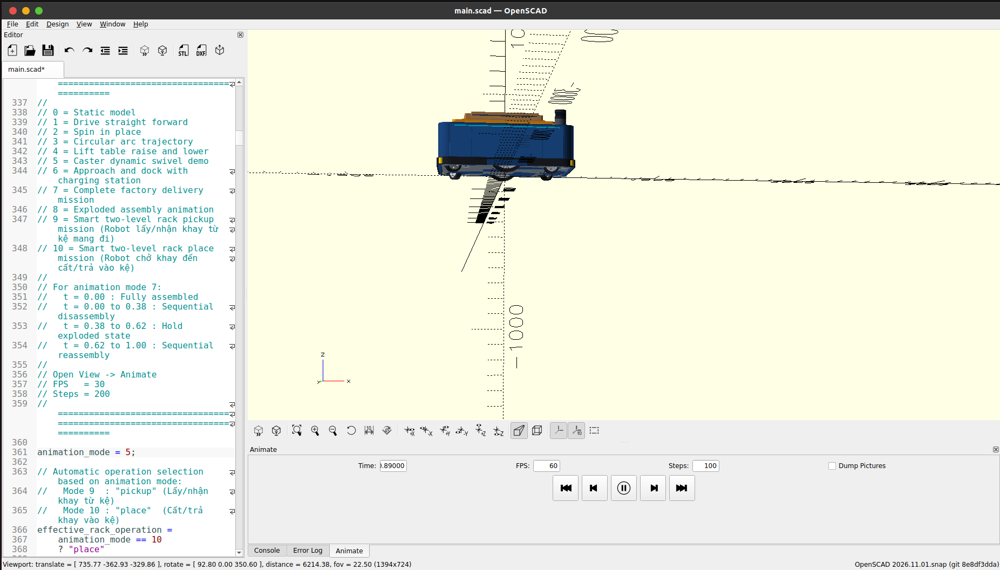 |

##### Chế độ 6 (`animation_mode = 6`): Tiếp cận và ghép nối với Trạm sạc tự động (`Approach and dock with charging station`)
Robot tự động xuất hiện cùng Trạm sạc (`charging_station()`), tiến dần về phía trước và dừng chính xác tại tọa độ `dock_robot_safe_x` để 2 lá đồng sạc ở mũi Robot khớp với cực sạc lò xo của trạm sạc (sai số $\le 2\text{ mm}$).
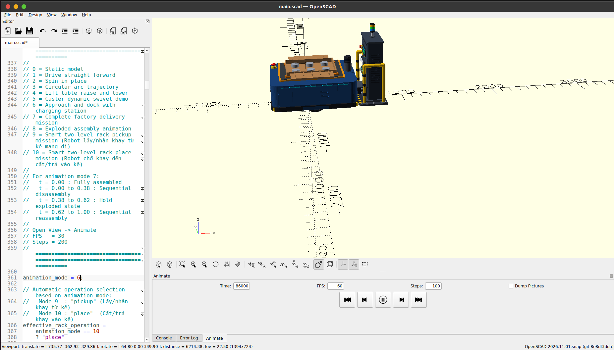

##### Chế độ 7 (`animation_mode = 7`): Chu trình nhiệm vụ giao hàng nhà máy hoàn chỉnh (`Complete factory delivery mission`)
Kịch bản tổng hợp nhiều giai đoạn theo thời gian `$t`:
- `t = 0.00 -> 0.18`: Robot di chuyển từ điểm xuất phát đến điểm giao hàng.
- `t = 0.18 -> 0.60`: Dừng tại điểm giao, nâng bàn nâng chữ X lên đỉnh (`290 mm`), trả hàng rồi hạ bàn nâng xuống.
- `t = 0.60 -> 1.00`: Di chuyển về trạm sạc và thực hiện ghép nối sạc điện tự động.
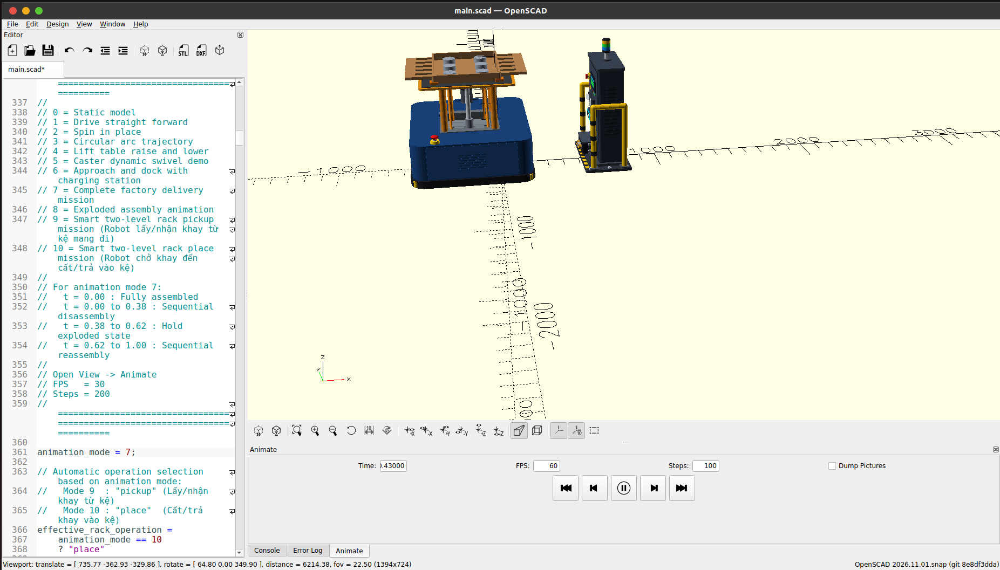

##### Chế độ 8 (`animation_mode = 8`): Hoạt ảnh tháo rời phân rã & lắp ráp tuần tự (`Exploded assembly animation`)
Tự động tách rời toàn bộ các cụm chi tiết theo từng lớp từ ngoài vào trong (`t = 0.00 -> 0.38`), giữ nguyên trạng thái phân rã (`t = 0.38 -> 0.62`) để quan sát rõ từng bo mạch **ESP32-S3**, **Jetson SBC**, **BMS**, **PDU**, **Motor Driver**, **IMU**, **Pin 48V-30Ah**, **Khung gầm**, **4 Bánh Caster**, **2 Bánh chủ động**, sau đó tự động lắp ráp lại hoàn chỉnh (`t = 0.62 -> 1.00`).
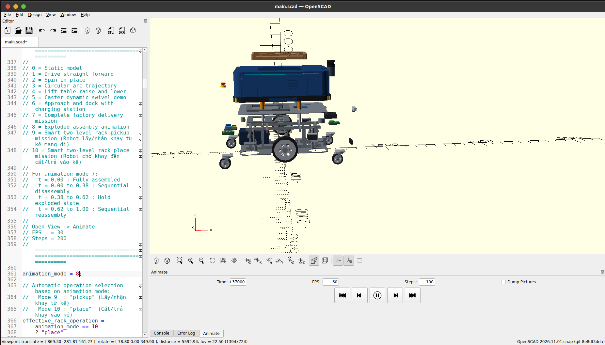

##### Chế độ 9 (`animation_mode = 9`): Nhiệm vụ lấy/nhận khay hàng từ Kệ thông minh 2 tầng (`Smart two-level rack pickup mission`)
Robot bật vùng quan sát Camera chiều sâu RealSense D455 (hình chóp xanh ngọc `camera_fov_debug()`), tiến vào lòng **Kệ chứa hàng thông minh 2 tầng (`smart_storage_rack`)** với bàn nâng hạ thấp, sau đó nâng bàn nâng nhấc khay hàng 20 kg khỏi thanh đỡ của kệ và lùi ra ngoài mang hàng đi.
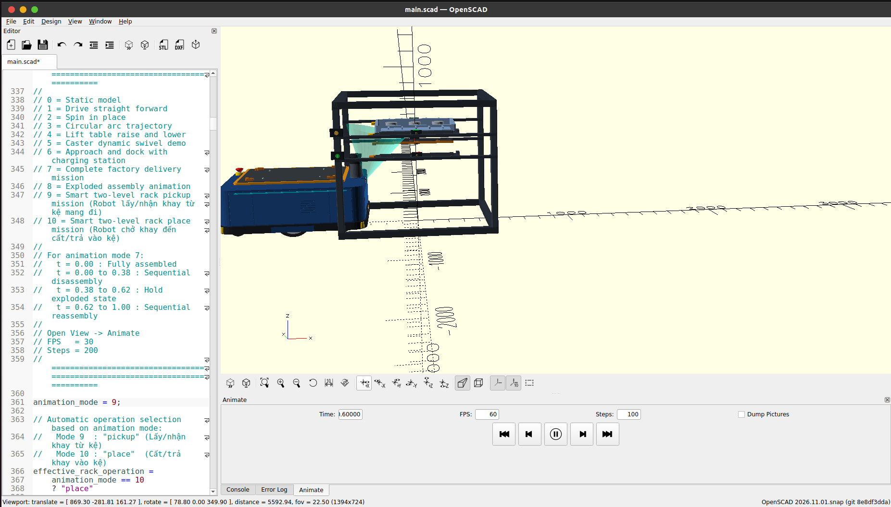

##### Chế độ 10 (`animation_mode = 10`): Nhiệm vụ cất/trả khay hàng vào Kệ thông minh 2 tầng (`Smart two-level rack place mission`)
Ngược lại với Chế độ 9: Robot chở sẵn khay hàng 20 kg trên lưng, nâng bàn nâng cao hơn tầng kệ mục tiêu, tiến vào giữa kệ, hạ bàn nâng xuống để 2 cánh của khay hàng (`payload_tray_wings`) gác lên thanh đỡ của kệ rồi lùi xe trống ra ngoài.
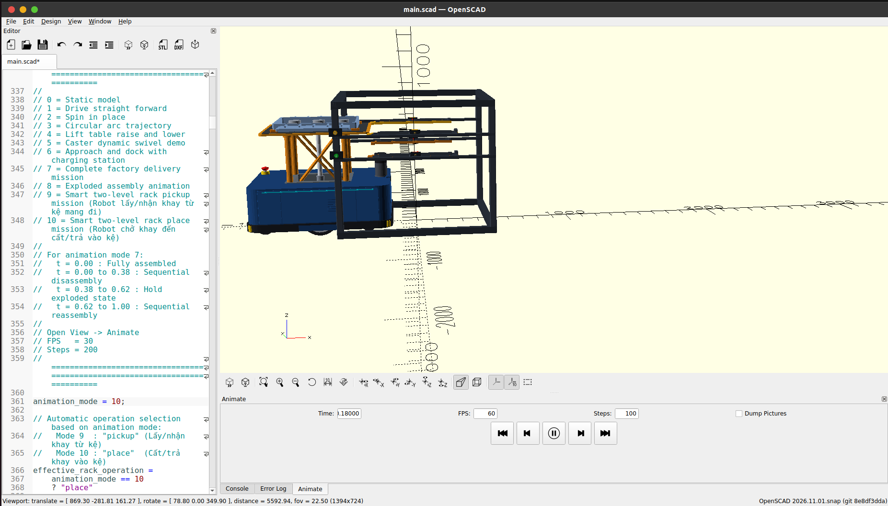

---

## PHẦN 2: CHI TIẾT TOÀN BỘ CHỨC NĂNG & CÚ PHÁP CỦA OPENSCAD

> **Lưu ý cú pháp cơ bản:** Mọi câu lệnh tạo hình trong OpenSCAD đều kết thúc bằng dấu chấm phẩy `;` hoặc áp dụng lên một khối lệnh con đặt trong cặp ngoặc nhọn `{ ... }`. Ghi chú 1 dòng dùng `//`, ghi chú nhiều dòng dùng `/* ... */`.

### 2.1. Nhóm hình khối 3D cơ bản (3D Primitives)

#### 1. Hình hộp chữ nhật / Lập phương: `cube()`
```openscad
// Cú pháp 1: Hình lập phương cạnh a đặt tại góc phần tư thứ nhất (từ [0,0,0] đến [a,a,a])
cube(size = 20, center = false);

// Cú pháp 2: Hình hộp chữ nhật kích thước [dài_X, rộng_Y, cao_Z]
// Khi center = true: Tâm hình hộp nằm chính xác tại gốc tọa độ [0, 0, 0]
// (tức X từ -425 đến +425, Y từ -290 đến +290, Z từ -3 đến +3) -> RẤT KHUYÊN DÙNG CHO ROBOT!
cube([850, 580, 6], center = true);
```

#### 2. Hình cầu: `sphere()`
```openscad
// Tạo hình cầu tâm tại [0, 0, 0] theo bán kính r hoặc đường kính d:
sphere(r = 35, $fn = 48);
sphere(d = 70, $fn = 48); // Bánh cầu tự lựa (ball caster) đường kính 70 mm
```

#### 3. Hình trụ, Hình nón, Hình nón cụt & Đa giác đều: `cylinder()`
```openscad
// 1. Hình trụ đứng dọc theo trục Z (mặc định đáy dưới ở Z=0, đáy trên ở Z=h)
cylinder(h = 60, d = 220, center = false);

// 2. Hình trụ có tâm đối xứng tại [0, 0, 0] (Z chạy từ -h/2 đến +h/2)
cylinder(h = 60, r = 110, center = true, $fn = 72);

// 3. Hình nón / Hình nón cụt (bán kính hoặc đường kính 2 đáy khác nhau: d1 ở dưới, d2 ở trên)
cylinder(h = 40, d1 = 80, d2 = 50, center = true); // Đế vát của cảm biến LiDAR
cylinder(h = 30, r1 = 20, r2 = 0);                 // Hình nón nhọn (mũi tên chỉ hướng)

// 4. Mẹo tạo đai ốc / đầu bulông lục giác hoặc bát giác bằng $fn nhỏ:
cylinder(h = 8, d = 14, $fn = 6); // Đầu bulông lục giác
cylinder(h = 10, d = 50, $fn = 8); // Trụ bát giác
```

#### 4. Khối đa diện tùy ý: `polyhedron()`
Dùng khi cần vẽ các khối 3D phức tạp như hình chóp cụt của vùng nhìn Camera (FOV Pyramid), vấu vát nghiêng đặc biệt:
```openscad
// points: danh sách tọa độ [x, y, z] của các đỉnh (đánh số từ 0)
// faces: danh sách các mặt, mỗi mặt là mảng chỉ số các đỉnh theo chiều kim đồng hồ khi nhìn từ ngoài vào
polyhedron(
    points = [
        [0, 0, 0],       // Đỉnh 0: Tâm quang học camera
        [500, -300, -200], // Đỉnh 1: Góc dưới phải
        [500,  300, -200], // Đỉnh 2: Góc dưới trái
        [500,  300,  200], // Đỉnh 3: Góc trên trái
        [500, -300,  200]  // Đỉnh 4: Góc trên phải
    ],
    faces = [
        [0, 1, 2], [0, 2, 3], [0, 3, 4], [0, 4, 1], // 4 mặt bên hình chóp
        [1, 4, 3, 2]                                // Mặt đáy phía trước
    ],
    convexity = 2
);
```

---

### 2.2. Nhóm hình học 2D cơ bản (2D Primitives) & Văn bản (Text)

Các hình 2D nằm trên mặt phẳng `XY` ($Z = 0$), thường được dùng làm mặt cắt ngang để đùn (`extrude`) lên thành khối 3D hoặc xuất bản vẽ cắt laser DXF/SVG:

```openscad
// 1. Hình chữ nhật / Hình vuông 2D: square()
square(size = [100, 50], center = true);

// 2. Hình tròn / Đa giác đều 2D: circle()
circle(r = 25, $fn = 64);
circle(d = 50, $fn = 6); // Lục giác đều 2D

// 3. Đa giác phẳng bất kỳ: polygon()
// Hỗ trợ cả việc khoét lỗ bên trong thông qua tham số paths:
polygon(
    points = [
        [0, 0], [100, 0], [80, 60], [20, 60], // 4 đỉnh biên ngoài (0,1,2,3)
        [30, 15], [70, 15], [60, 45], [40, 45] // 4 đỉnh lỗ khoét trong (4,5,6,7)
    ],
    paths = [
        [0, 1, 2, 3], // Đường bao ngoài
        [4, 5, 6, 7]  // Đường bao lỗ trong
    ]
);

// 4. Chữ viết 2D: text() (Dùng để khắc nhãn tên linh kiện hoặc logo lên thân robot)
text(
    text = "PTIT AMR-01",
    size = 18,
    font = "Liberation Sans:style=Bold",
    halign = "center", // "left", "center", "right"
    valign = "center"  // "top", "center", "baseline", "bottom"
);
```

---

### 2.3. Quét 2D thành 3D (Extrusion) & Chiếu 3D xuống 2D (Projection)

#### 1. Đùn thẳng 2D theo trục Z: `linear_extrude()`
Biến một biên dạng 2D trên mặt phẳng `XY` thành vật thể 3D có độ dày `height` dọc theo trục `Z`:
```openscad
// Đùn chữ 2D thành chữ nổi 3D dày 4 mm:
linear_extrude(height = 4, center = true, convexity = 10)
    text("AMR", size = 20, halign = "center", valign = "center");

// Đùn kết hợp xoắn (twist) và thu phóng (scale) để tạo bánh răng nghiêng hoặc lò xo:
linear_extrude(height = 50, twist = 180, scale = 0.8, slices = 60)
    square([30, 10], center = true);
```

#### 2. Quét tròn xoay 2D quanh trục Z: `rotate_extrude()`
Quay một biên dạng 2D (nằm ở nửa mặt phẳng $X \ge 0$) xung quanh trục $Z$. Rất hữu ích khi tiện rãnh puly, lốp xe bo tròn, vòng bi:
```openscad
// Tạo vòng đệm / lốp xe tròn xoay quanh trục Z:
rotate_extrude(angle = 360, convexity = 4, $fn = 72)
    translate([80, 0, 0]) // Dịch mặt cắt ra cách tâm quay 80 mm
        circle(d = 25);   // Mặt cắt ngang hình tròn -> Tạo thành hình xuyến (Torus)
```

#### 3. Chiếu vật thể 3D xuống mặt phẳng 2D: `projection()`
```openscad
// cut = false: Hình chiếu bằng (bóng của toàn bộ vật thể 3D lên mặt phẳng XY)
projection(cut = false) chassis_bottom();

// cut = true: Mặt cắt ngang của vật thể tại đúng lát cắt phẳng Z = 0
projection(cut = true) translate([0, 0, -10]) chassis_bottom();
```

---

### 2.4. Các phép biến đổi hình học (Transformations)

Trong OpenSCAD, các phép biến đổi được viết **từ ngoài vào trong** (lệnh viết trước áp dụng sau, lệnh sát vật thể nhất áp dụng trước, tuân theo phép nhân ma trận $T \cdot R \cdot S \cdot v$):

```openscad
// 1. Tịnh tiến (Dịch chuyển theo [X, Y, Z]): translate()
translate([368, 0, 390])
    lidar_2d();

// 2. Xoay theo góc Euler [Roll_X, Pitch_Y, Yaw_Z] (tính bằng độ): rotate()
// Lưu ý: rotate([rx, ry, rz]) xoay lần lượt quanh trục X -> trục Y -> trục Z
// Điều này TƯƠNG ĐƯƠNG HOÀN TOÀN với thuộc tính rpy="rx ry rz" (radian) trong URDF!
rotate([90, 0, 0])
    cylinder(h = 60, d = 220, center = true); // Xoay hình trụ từ trục Z sang nằm ngang theo trục Y (làm bánh xe)

// Xoay một góc a quanh một vector trục v bất kỳ:
rotate(a = 45, v = [0, 1, 0])
    cube([100, 20, 20], center = true);

// 3. Co giãn tỷ lệ: scale() và resize()
scale([1.5, 1.0, 0.5]) sphere(r = 20);          // Tạo khối elipsoid theo hệ số nhân
resize([120, 80, 40]) sphere(r = 20);           // Ép kích thước bao ngoài về đúng [120, 80, 40] mm

// 4. Đối xứng qua mặt phẳng pháp tuyến [nx, ny, nz]: mirror()
// Rất hay dùng để tạo cụm giá đỡ bên phải từ cụm bên trái (đối xứng qua mặt phẳng XZ, pháp tuyến Y=[0,1,0]):
mirror([0, 1, 0])
    left_mounting_bracket();

// 5. Tô màu và độ trong suốt (RGBA từ 0.0 -> 1.0 hoặc tên màu CSS): color()
color("SteelBlue", 0.9) cube([100, 100, 10], center = true);
color([0.10, 0.26, 0.48, 1.0]) body_shell_main(); // Màu xanh công nghiệp đậm

// 6. Phép biến đổi bằng Ma trận đồng nhất 4x4: multmatrix()
// Trực tiếp áp dụng ma trận chuyển đổi 4x4 (Homogeneous Transformation Matrix SE(3) trong Robotics):
multmatrix(m = [
    [cos(30), -sin(30), 0, 100],
    [sin(30),  cos(30), 0,  50],
    [0,        0,       1,  20],
    [0,        0,       0,   1]
]) cube([40, 20, 10]);
```

---

### 2.5. Các phép toán Boolean CSG (Constructive Solid Geometry)

Đây là "trái tim" của OpenSCAD để tạo ra mọi chi tiết cơ khí từ đơn giản đến phức tạp:

```openscad
// 1. Phép HỢP (Gộp nhiều khối thành 1 khối thống nhất): union()
union() {
    chassis_bottom();
    chassis_top();
    chassis_longitudinal_beams();
}

// 2. Phép HIỆU (Lấy khối ĐẦU TIÊN trừ đi tất cả các khối phía sau): difference()
// QUY TẮC VÀNG: Luôn cộng thêm một lượng nhỏ eps = 0.05 mm vào chiều dài khối cắt
// để mặt cắt nhô hẳn ra ngoài, tránh hiện tượng trùng mặt (Z-fighting / non-manifold mesh)!
eps = 0.05;
difference() {
    // Khối gốc (Thân mâm bánh xe):
    cylinder(h = 60, d = 150, center = true);

    // Các khối đem đi đục/khoét (Lỗ trục động cơ đường kính 24 mm):
    cylinder(h = 60 + 2 * eps, d = 24, center = true);
}

// 3. Phép GIAO (Chỉ giữ lại phần thể tích chung giao nhau giữa các khối): intersection()
intersection() {
    cube([100, 100, 100], center = true);
    sphere(d = 130); // Tạo khối lập phương có 8 góc được vát cầu
}
```

---

### 2.6. Các phép toán hình học nâng cao (`hull`, `minkowski`, `offset`)

#### 1. Bao lồi 2D / 3D: `hull()`
Hàm `hull()` căng một "màng bọc" bao quanh tất cả các vật thể con bên trong nó. Đây là công cụ **nhanh và hiệu quả nhất** để tạo tấm đế bo tròn 4 góc, tay đòn robot (robot arm link), hoặc vấu đỡ cơ khí:
```openscad
// Ví dụ 1: Tạo tấm khung gầm (Chassis Plate) dài 850, rộng 580, dày 6 mm, bo tròn 4 góc bán kính R=45 mm:
module rounded_plate(length, width, thickness, corner_r) {
    hull() {
        for (sx = [-1, 1], sy = [-1, 1]) {
            translate([
                sx * (length / 2 - corner_r),
                sy * (width  / 2 - corner_r),
                0
            ])
                cylinder(h = thickness, r = corner_r, center = true);
        }
    }
}

// Ví dụ 2: Tạo thanh truyền (link) nối từ khớp lớn (d=40) sang khớp nhỏ (d=24) cách nhau 200 mm:
hull() {
    cylinder(h = 12, d = 40, center = true);
    translate([200, 0, 0]) cylinder(h = 12, d = 24, center = true);
}
```

#### 2. Tổng Minkowski: `minkowski()`
Quét một vật thể thứ hai dọc theo toàn bộ biên mặt của vật thể thứ nhất (dùng để bo tròn mọi cạnh 3D của một khối hộp với một hình cầu hoặc hình trụ):
```openscad
// Hộp có mọi cạnh và góc đều được bo tròn bán kính r = 5 mm:
minkowski() {
    cube([90, 90, 40], center = true);
    sphere(r = 5, $fn = 24); // Kích thước tổng sau minkowski sẽ là [100, 100, 50]
}
```
*(Lưu ý: `minkowski()` trên 3D tốn rất nhiều thời gian tính toán khi bấm `F6`, do đó khi thiết kế robot lớn nên ưu tiên dùng `hull()` của 4 hình trụ hoặc `linear_extrude()` kèm `offset()`).*

#### 3. Bo góc / Phóng viền 2D: `offset()`
```openscad
// Bo tròn góc ngoài (r > 0) hoặc vát góc (chamfer = true) cho biên dạng 2D:
linear_extrude(height = 10)
    offset(r = 8)
        square([100, 60], center = true);
```

---

### 2.7. Biến, Toán tử, Câu lệnh điều kiện và Vòng lặp

```openscad
// 1. Khai báo biến & Toán tử 3 ngôi (Ternary operator ? : )
robot_length = 850;
robot_width  = 580;
is_heavy_duty = true;
plate_thickness = is_heavy_duty ? 8 : 5;

// 2. Mảng (Vector / List) và truy cập phần tử (chỉ số bắt đầu từ 0):
caster_positions = [
    [ 310,  245], // Góc trước - trái
    [ 310, -245], // Góc trước - phải
    [-310,  245], // Góc sau - trái
    [-310, -245]  // Góc sau - phải
];
first_x = caster_positions[0][0]; // 310

// 3. Vòng lặp for() duyệt qua dãy số [start : step : end] hoặc duyệt qua mảng:
// Đặt 4 cụm bánh caster vào 4 góc robot:
for (pt = caster_positions) {
    translate([pt[0], pt[1], 0])
        caster_assembly();
}

// Tạo 6 nan hoa (spokes) cách đều 60 độ cho mâm bánh xe:
for (angle = [0 : 60 : 300]) {
    rotate([0, 0, angle])
        cube([90, 12, 16], center = true);
}

// 4. Câu lệnh điều kiện if - else:
if (show_sensors) {
    lidar_2d();
    realsense_d455();
} else {
    echo("Che do an cam bien dang bat");
}
```

---

### 2.8. Module và Function (Xây dựng thư viện tái sử dụng)

Trong OpenSCAD, cần phân biệt rõ **Module** và **Function**:
- **`module`**: Sinh ra **đối tượng hình học 3D/2D** (tương tự như hàm `void` vẽ hình hoặc một Component/Sub-assembly).
- **`function`**: Tính toán và **trả về một giá trị** (số, chuỗi, vector, ma trận).

```openscad
// 1. Định nghĩa Function toán học (ví dụ nội suy tuyến tính lerp & làm mượt chuyển động smoothstep):
function lerp(a, b, t) = a + (b - a) * t;
function clamp(v, lo, hi) = min(max(v, lo), hi);
function smoothstep(t) =
    let(u = clamp(t, 0, 1))
    u * u * (3 - 2 * u);

// Các hàm toán học dựng sẵn:
// sin(deg), cos(deg), tan(deg), asin(x), acos(x), atan(x), atan2(y, x)
// sqrt(x), pow(a, b), abs(x), min(a, b), max(a, b), norm([x,y,z]), cross(u, v), len(list), str(...)

// 2. Định nghĩa Module có tham số mặc định (Default Parameters):
module mounting_hole_pattern(pitch_x = 100, pitch_y = 80, hole_d = 6.5, depth = 20) {
    for (sx = [-1, 1], sy = [-1, 1]) {
        translate([sx * pitch_x / 2, sy * pitch_y / 2, 0])
            cylinder(h = depth, d = hole_d, center = true);
    }
}

// 3. Module sử dụng children() (Biến đổi áp dụng lên các khối con bên trong):
module mirror_copy(vec = [0, 1, 0]) {
    children();
    mirror(vec) children();
}

// Cách dùng mirror_copy: Vẽ 1 bên trái, tự động có cả bên phải đối xứng!
mirror_copy([0, 1, 0])
    translate([0, 310, 110])
        drive_wheel();
```

---

### 2.9. Quản lý đa file: Sự khác biệt giữa `include` và `use`

Đây là kiến thức **CỰC KỲ QUAN TRỌNG** khi tách các bộ phận từ file `main.scad` ra từng file `.scad` riêng để xuất STL cho URDF:

| Câu lệnh | Cơ chế hoạt động | Khi nào sử dụng? |
| :--- | :--- | :--- |
| **`include <file.scad>`** | Chèn toàn bộ nội dung của `file.scad` vào vị trí gọi (lấy cả **biến toàn cục**, **module**, **function** VÀ **thực thi luôn các lệnh vẽ hình ở cấp cao nhất** trong `file.scad`). | Dùng khi muốn kế thừa toàn bộ biến cấu hình trong `main.scad` (kết hợp cờ `export_only = true;` để chặn vẽ cả cảnh lớn). |
| **`use <file.scad>`** | Chỉ nạp các **`module`** và **`function`** từ `file.scad`. **KHÔNG thực thi** bất kỳ lệnh vẽ hình nào ở ngoài module và **KHÔNG nạp biến toàn cục**. | Dùng trong các file `export_left_wheel.scad`, `export_lidar.scad` khi chỉ muốn gọi đúng 1 module con (ví dụ `drive_wheel()`, `lidar_2d()`) mà không vẽ toàn bộ robot! |

---

### 2.10. Nhập/Xuất file (Import/Export), Debug (`echo`, `assert`) và Hoạt ảnh (`$t`)

```openscad
// 1. Nhập file mesh có sẵn từ bên ngoài (.stl, .off, .3mf, .dxf, .svg):
import("meshes/sensor_housing.stl", convexity = 4);

// 2. In thông tin ra Console để kiểm tra thông số thiết kế: echo()
echo(str("Ban kinh banh xe = ", drive_wheel_diameter / 2, " mm"));

// 3. Kiểm tra ràng buộc kỹ thuật tự động: assert()
// Nếu điều kiện sai, OpenSCAD lập tức dừng biên dịch và báo lỗi đỏ rõ ràng!
assert(robot_width <= corridor_width - 2 * side_clearance,
       "LOI THIET KE: Chieu rong robot vuot qua gioi han hanh lang an toan!");

// 4. Biến thời gian hoạt ảnh $t (chạy tuần hoàn từ 0.0 đến 1.0):
// Để bật hoạt ảnh trong GUI: Vào menu View -> Animate, nhập FPS = 60, Steps = 100.
// Ví dụ xoay bánh xe 360 độ theo thời gian $t:
rotate([0, $t * 360, 0])
    drive_wheel(1, 0);
```

| Minh họa biến `$t` khi chạy thẳng (`animation_mode = 1`, `Time = 0.52`) | Minh họa biến `$t` khi xoay tại chỗ (`animation_mode = 2`, `Time = 0.76`) |
| :---: | :---: |
|  |  |

---

## PHẦN 3: CÁCH CHẾ TẠO ROBOT TRONG OPENSCAD CHI TIẾT TỪNG BƯỚC

Để việc chuyển đổi sang URDF/ROS 2 sau này diễn ra trơn tru, không bị ngược chiều tiến/lùi hay lệch tâm quay bánh xe, quá trình thiết kế robot trong OpenSCAD cần tuân thủ quy trình 5 bước chuẩn công nghiệp dưới đây (minh họa trực tiếp từ dự án **Factory Delivery AMR** trong thư mục `cad/main.scad`).

---

### 3.1. Bước 1: Quy ước Hệ trục tọa độ chuẩn ROS (REP-103)

**Sai lầm phổ biến nhất** của người mới thiết kế robot trong CAD là chọn trục `+Y` làm hướng tiến hoặc đặt mặt đất ở một tọa độ Z ngẫu nhiên. Khi đưa sang ROS 2 (`nav2`, `diff_drive_controller`), robot sẽ đi ngang hoặc chìm xuống dưới sàn Gazebo!

**Quy ước bắt buộc ngay từ dòng đầu tiên trong OpenSCAD (Chuẩn ROS REP-103):**
- **Trục `+X` (Màu đỏ):** Hướng tiến về phía trước của robot (**Forward**). Mũi robot nằm ở $+X$, đuôi robot nằm ở $-X$.
- **Trục `+Y` (Màu xanh lá):** Hướng sang bên trái của robot (**Left**). Bánh xe trái nằm ở $+Y$, bánh xe phải nằm ở $-Y$.
- **Trục `+Z` (Màu xanh dương):** Hướng thẳng đứng lên trời (**Upward**).
- **Mặt sàn (Ground Plane):** Nằm chính xác tại mặt phẳng **`Z = 0`**. Điểm thấp nhất của lốp bánh xe chủ động và bánh caster phải tiếp xúc đúng mặt phẳng `Z = 0`.
- **Gốc tọa độ `(0, 0, 0)`:** Tâm hình chiếu bằng của thân robot chiếu xuống mặt sàn (`Z = 0`), đồng thời trục bánh xe chủ động nằm tại `X = 0`.

```
                  +Z (Up / Lên trên)
                   |
                   |     +X (Forward / Hướng tiến của Robot)
                   |    /
                   |   /
                   |  /
   +Y (Left) ------+------- -Y (Right)
  (Bánh trái)     (0,0,0)   (Bánh phải)
              Mặt sàn Z = 0
```

---

### 3.2. Bước 2: Thiết kế Tham số hóa (Parametric Design) & Kiểm tra Ràng buộc

Tuyệt đối **không viết số cố định (magic numbers)** rải rác bên trong các lệnh `cube()`, `translate()`. Hãy gom toàn bộ thông số vào phần đầu file `.scad` và tính các biến dẫn xuất tự động:

```openscad
// ============================================================================
// 1. THÔNG SỐ KÍCH THƯỚC TỔNG THỂ (Đơn vị: mm)
// ============================================================================
eps = 0.05; // Dung sai cắt Boolean CSG

robot_length        = 850; // Chiều dài tổng thể theo trục X
robot_width         = 580; // Chiều rộng tổng thể theo trục Y
robot_body_height   = 300; // Chiều cao thân vỏ chính
ground_clearance    = 40;  // Khoảng sáng gầm xe (đáy khung gầm ở Z = 40 mm)

// ============================================================================
// 2. HỆ THỐNG TRUYỀN ĐỘNG VI SAI (DIFFERENTIAL DRIVE)
// ============================================================================
drive_wheel_diameter = 220;                        // Đường kính bánh chủ động
drive_wheel_radius   = drive_wheel_diameter / 2;   // Bán kính R = 110 mm
drive_wheel_width    = 60;                         // Bề rộng lốp = 60 mm
drive_wheel_track    = 620;                        // Khoảng cách tâm 2 bánh trái - phải (Y = +-310 mm)
drive_wheel_axle_z   = drive_wheel_radius;         // Tâm trục bánh xe ở Z = +110 mm (để đáy lốp chạm Z = 0!)

// ============================================================================
// 3. BÁNH XE TỰ LỰA 4 GÓC (4 CORNER SWIVEL CASTERS)
// ============================================================================
caster_wheel_diameter = 70;                        // Đường kính bánh caster = 70 mm (R = 35 mm)
caster_offset_x       = 310;                       // Tọa độ X của caster trước/sau (+-310 mm)
caster_offset_y       = 245;                       // Tọa độ Y của caster trái/phải (+-245 mm)

// ============================================================================
// 4. CƠ CẤU BÀN NÂNG & CẢM BIẾN (LIFT & SENSORS)
// ============================================================================
lift_center_x        = -15;                        // Tâm bàn nâng lệch nhẹ về sau
lift_lowered_deck_z  = 330;                        // Độ cao mặt bàn nâng khi hạ thấp nhất
lift_travel          = 290;                        // Hành trình nâng tối đa (0 -> 290 mm)

lidar_pos_x          = 368;                        // Vị trí X của LiDAR 2D ở mũi trước
lidar_mount_height   = 390;                        // Độ cao Z của tâm quét LiDAR
camera_pos_x         = 415;                        // Vị trí X của Camera RealSense D455
```

---

### 3.3. Bước 3: Phân rã Robot thành các Module theo Cây động học (Kinematic Tree)

Trước khi vẽ chi tiết, bạn phải xác định rõ **bộ phận nào đứng yên so với khung xe** và **bộ phận nào chuyển động độc lập** để chia thành các `module` tương ứng với các `link` trong URDF:

| Phân nhóm | Tên Link trong URDF | Module trong OpenSCAD (`cad/main.scad`) | Loại Khớp (`joint`) | Tọa độ Gốc của Link `(X, Y, Z)` [mm] |
| :--- | :--- | :--- | :---: | :---: |
| **Gốc tọa độ** | `base_footprint` -> `base_link` | Hệ tọa độ gốc của cảnh `[0, 0, 0]` | `fixed` | `[0, 0, 0]` |
| **Khung & Vỏ tĩnh** | `chassis_link`, `body_shell_link`, `battery_system_link`, `electronics_link` | `chassis_bottom()`, `chassis_top()`, `body_shell()`, `battery_pack()`, `bms()`... | `fixed` | `[0, 0, 0]` (Chung gốc với `base_link`) |
| **Bánh chủ động Trái** | `left_wheel_link` | `drive_wheel(side = +1, angle)` | `continuous` (Quay quanh trục Y) | `[0, +310, +110]` |
| **Bánh chủ động Phải** | `right_wheel_link` | `drive_wheel(side = -1, angle)` | `continuous` (Quay quanh trục Y) | `[0, -310, +110]` |
| **4 Điểm chạm Caster** | `caster_front_left_link` (và FR, RL, RR) | `caster_assembly(pt, swivel, roll)` | `fixed` (Dùng cầu ma sát $\mu=0.001$) | `[±310, ±245, +35]` |
| **Khung nâng tĩnh** | `lift_fixed_link` | `lift_fixed_part()` | `fixed` | `[0, 0, 0]` |
| **Xy-lanh nâng** | `lift_ram_link` | `lift_actuator_ram(lift_h)` | `prismatic` (Trượt dọc trục Z) | `[-15, 0, +198]` |
| **Mặt bàn nâng động** | `lift_platform_link` | `lift_moving_part(lift_h, false)` | `prismatic` (Trượt dọc trục Z) | `[-15, 0, +330]` |
| **4 Thanh cắt kéo** | `scissor_left_a_link`... | `scissor_bars()` | `revolute` + `<mimic>` theo `lift_joint` | `[-15 ± 135, ±112, +268]` |
| **Khay hàng 20kg** | `payload_link` | `payload_box(lift_h)` | `fixed` (Gắn trên `lift_platform_link`) | `[0, 0, +2]` (so với bàn nâng) |
| **Cảm biến LiDAR 2D** | `lidar_link` | `lidar_2d()` | `fixed` | `[+368, 0, +390]` |
| **Camera D455** | `camera_link` | `realsense_d455()` | `fixed` | `[+415, 0, +285]` |

---

### 3.4. Bước 4: Thiết kế chi tiết từng cụm cơ khí & cảm biến trong OpenSCAD

Dưới đây là mẫu thiết kế 4 cụm tiêu biểu nhất của một Robot tự hành (AMR/AGV):

#### A. Thiết kế Khung gầm chịu lực 2 tầng (`chassis_bottom` & `chassis_top`)
Sử dụng `hull()` của 4 trụ góc kết hợp `difference()` để khoét hốc bánh xe chủ động ở hai bên sườn ($Y = \pm 310\text{ mm}$):
```openscad
module rounded_plate(length, width, thickness, r = 45) {
    hull() {
        for (sx = [-1, 1], sy = [-1, 1]) {
            translate([sx * (length / 2 - r), sy * (width / 2 - r), 0])
                cylinder(h = thickness, r = r, center = true);
        }
    }
}

module chassis_bottom() {
    color([0.28, 0.30, 0.33])
    translate([0, 0, ground_clearance + 3]) // Tâm tấm đáy dày 6 mm ở Z = 43 mm
    difference() {
        rounded_plate(robot_length - 20, robot_width - 20, 6, 40);

        // Khoét 2 hốc chữ nhật bên trái (+Y) và bên phải (-Y) cho bánh xe chủ động:
        for (side = [-1, 1]) {
            translate([0, side * (drive_wheel_track / 2), 0])
                cube([drive_wheel_diameter + 30, drive_wheel_width + 24, 20], center = true);
        }
    }
}
```

#### B. Thiết kế Bánh xe chủ động (`drive_wheel`) tách biệt Lốp & Mâm nhôm CNC
**Mẹo quan trọng:** Hãy tách riêng `drive_wheel_tire_only(side, angle)` (lốp cao su đen) và `drive_wheel_hub_only(side, angle)` (mâm nhôm bạc có nan hoa) để vừa có thể gộp lại trong `drive_wheel()`, vừa có thể xuất ra 2 file STL riêng biệt tạo **bánh xe 2 màu** trong URDF!
```openscad
// 1. Phần Lốp cao su đen (Tire):
module drive_wheel_tire_only(side = 1, wheel_angle = 0) {
    color([0.14, 0.14, 0.16])
    translate([0, side * (drive_wheel_track / 2), drive_wheel_axle_z])
    rotate([0, wheel_angle, 0]) // Quay bánh xe quanh trục Y khi mô phỏng animation
    rotate([90, 0, 0])          // Dựng hình trụ nằm ngang dọc theo trục Y
    difference() {
        cylinder(h = drive_wheel_width, d = drive_wheel_diameter, center = true);
        cylinder(h = drive_wheel_width + 2 * eps, d = drive_wheel_diameter * 0.62, center = true);
    }
}

// 2. Phần Mâm nhôm CNC (Spoked Hub):
module drive_wheel_hub_only(side = 1, wheel_angle = 0) {
    color([0.78, 0.80, 0.84])
    translate([0, side * (drive_wheel_track / 2), drive_wheel_axle_z])
    rotate([0, wheel_angle, 0])
    rotate([90, 0, 0])
    union() {
        // Vành mâm ngoài & Moay-ơ tâm trục:
        difference() {
            cylinder(h = drive_wheel_width - 6, d = drive_wheel_diameter * 0.62, center = true);
            cylinder(h = drive_wheel_width, d = drive_wheel_diameter * 0.48, center = true);
        }
        cylinder(h = drive_wheel_width - 4, d = 52, center = true);
        // 6 nan hoa (spokes) bố trí đều 60 độ:
        for (a = [0 : 60 : 300]) {
            rotate([0, 0, a])
                cube([drive_wheel_diameter * 0.54, 12, 14], center = true);
        }
    }
}

// 3. Module bánh xe hoàn chỉnh:
module drive_wheel(side = 1, wheel_angle = 0) {
    drive_wheel_tire_only(side, wheel_angle);
    drive_wheel_hub_only(side, wheel_angle);
}
```


*Hình 3.1: Kiểm tra bố trí cơ khí dưới gầm xe (`animation_mode = 5`): 2 bánh xe chủ động ở tâm (`X = 0, Y = ±310 mm`) và 4 bánh xe tự lựa xoay $360^\circ$ ở 4 góc (`X = ±310, Y = ±245 mm`) cùng tiếp xúc mặt phẳng sàn `Z = 0`.*

#### C. Thiết kế Cảm biến LiDAR 2D (`lidar_2d`)
```openscad
module lidar_pedestal_only() {
    pedestal_h = lidar_mount_height - robot_body_height; // 390 - 300 = 90 mm
    color([0.28, 0.30, 0.34])
    translate([lidar_pos_x, 0, robot_body_height + pedestal_h / 2])
        cylinder(h = pedestal_h, d1 = 92, d2 = 78, center = true);
}

module lidar_scanner_unit_only() {
    color([0.12, 0.12, 0.14])
    translate([lidar_pos_x, 0, lidar_mount_height + lidar_height / 2])
        cylinder(h = lidar_height, d = lidar_diameter, center = true);
}

module lidar_2d() {
    lidar_pedestal_only();
    lidar_scanner_unit_only();
}
```

---

### 3.5. Bước 5: Lắp ráp tổng thể, Kiểm tra vùng quét cảm biến & Bản vẽ phân rã (Exploded View)

Sau khi có đầy đủ các module con, ta gom chúng vào một module lắp ráp tổng thể `factory_delivery_amr()`. Đặc biệt, hãy thêm biến `explode_distance` (hoặc `explode_gap`) để tạo **Bản vẽ phân rã 3D (Exploded View)** phục vụ báo cáo kỹ thuật và kiểm tra lắp ghép:

```openscad
module factory_delivery_amr(lift_h = 0, left_wheel_angle = 0, right_wheel_angle = 0, explode_gap = 0) {
    // 1. Khung gầm cố định (Đứng yên làm chuẩn):
    chassis_bottom();
    chassis_top();

    // 2. Vỏ thân xe (Khi explode_gap > 0 sẽ nhấc cao lên theo trục +Z):
    translate([0, 0, explode_gap * 1.4])
        body_shell();

    // 3. Hai bánh xe chủ động Trái (+1) và Phải (-1) (Tách ra 2 bên theo trục +-Y):
    for (side = [-1, 1]) {
        translate([0, side * explode_gap * 1.2, 0])
            drive_wheel(side, side > 0 ? left_wheel_angle : right_wheel_angle);
    }

    // 4. Bốn bánh xe caster ở 4 góc:
    for (pt = caster_positions) {
        caster_assembly(pt, 0, 0);
    }

    // 5. Hệ thống bàn nâng & khay tải hàng 20kg:
    lift_fixed_part();
    lift_actuator_ram(lift_h);
    lift_moving_part(lift_h, true);
    payload_box(lift_h);

    // 6. Cảm biến LiDAR & Camera D455:
    lidar_2d();
    realsense_d455();
}

// ============================================================================
// CHỐT CHẶN QUAN TRỌNG Ở CUỐI FILE main.scad:
// Chỉ vẽ cảnh tổng thể khi mở trực tiếp main.scad (export_only chưa được định nghĩa).
// Khi file export_*.scad gọi `include <main.scad>` kèm `export_only = true;`,
// khối if này sẽ KHÔNG CHẠY, giúp chỉ xuất đúng chi tiết cần lấy!
// ============================================================================
if (is_undef(export_only)) {
    factory_delivery_amr();
}
```

#### Minh họa trực quan các kịch bản kiểm chứng thiết kế tổng thể trong `cad/main.scad`:

| 1. Kiểm tra nâng/hạ bàn nâng chữ X (`animation_mode = 4`) | 2. Kiểm tra ghép nối Trạm sạc tự động (`animation_mode = 6`) |
| :---: | :---: |
|  |  |
| **3. Kiểm tra góc nhìn Camera FOV & Lấy khay từ kệ (`animation_mode = 9`)** | **4. Kiểm tra trả khay hàng vào kệ 2 tầng (`animation_mode = 10`)** |
|  |  |
| **5. Chu trình giao hàng + sạc tự động (`animation_mode = 7`)** | **6. Phân rã tự động toàn bộ linh kiện (`animation_mode = 8`)** |
|  |  |

---

## PHẦN 4: QUY TRÌNH CHUYỂN ĐỔI TỪ OPENSCAD SANG URDF / XACRO CHI TIẾT

### 4.1. Nguyên lý cốt lõi khi chuyển từ CAD sang URDF

Một mô hình Robot trong **URDF (Unified Robot Description Format)** không phải là một khối 3D tĩnh duy nhất, mà là một **Cây động học (Kinematic Tree)** gồm:
1. **`<link>` (Khâu cứng):** Đại diện cho một bộ phận cứng của robot (khung xe, bánh xe trái, bánh xe phải, bàn nâng, cảm biến LiDAR...). Mỗi `<link>` chứa 3 thành phần:
   - **`<visual>`**: Hình dáng hiển thị 3D (thường nạp từ file lưới `.stl` xuất ra bởi OpenSCAD) và màu sắc `<material>`.
   - **`<collision>`**: Hình khối va chạm vật lý (nên dùng hình khối cơ bản `<box>`, `<cylinder>`, `<sphere>` để Gazebo tính toán nhanh và ổn định).
   - **`<inertial>`**: Khối lượng `<mass>` (kg) và ma trận mô-men quán tính `<inertia>` ($\text{kg}\cdot\text{m}^2$).
2. **`<joint>` (Khớp nối):** Liên kết một `<parent link>` (khâu cha) với một `<child link>` (khâu con), quy định vị trí tương đối `<origin xyz="..." rpy="..."/>` và trục chuyển động `<axis xyz="..."/>`.

---

### 4.2. QUY TẮC VÀNG: Dịch chuyển gốc tọa độ (Origin Alignment) khi xuất từng Link

Đây là bước **quan trọng nhất quyết định thành bại** khi chuyển từ OpenSCAD sang URDF:

> **Vấn đề:** Trong file tổng `main.scad`, bánh xe trái được vẽ tại tọa độ lắp ráp `[0, +310, +110]` mm. Nếu bạn xuất trực tiếp bánh xe đó ra file `left_wheel.stl` mà không dịch về gốc `[0, 0, 0]`, thì tâm của file STL vẫn nằm ở `[0, 0, 0]` (dưới gầm xe), còn hình dáng bánh xe lại nằm lệch ở `[0, 310, 110]`. Khi khai báo khớp quay trong URDF, bánh xe sẽ **quay lệch tâm (đảo như rang lạc)** xung quanh gầm xe!

#### Giải pháp chuẩn cho 2 loại Link:

#### Trường hợp 1: Các Link gắn cố định (`fixed` joint) vào `base_link`
- **Trong OpenSCAD (`export_chassis.scad`):** Giữ nguyên vị trí lắp ráp trong hệ tọa độ `base_link` (không cần `translate` ngược).
  ```openscad
  // FILE: cad/export_chassis.scad
  export_only = true;
  include <main.scad>

  union() {
      chassis_bottom();
      chassis_top();
      chassis_longitudinal_beams();
      chassis_cross_beams();
  }
  ```
- **Trong URDF (`factory_delivery_amr.urdf.xacro`):** Đặt `<origin xyz="0 0 0" rpy="0 0 0"/>` ở cả `<visual>` và `<joint>`:
  ```xml
  <joint name="chassis_joint" type="fixed">
    <parent link="base_link"/>
    <child link="chassis_link"/>
    <origin xyz="0 0 0" rpy="0 0 0"/>
  </joint>
  ```

#### Trường hợp 2: Các Link chuyển động (`continuous`, `revolute`, `prismatic`) hoặc Link cảm biến (`lidar_link`, `camera_link`)
- **Nguyên tắc:** Nếu trong `main.scad`, tâm khớp quay (hoặc tâm cảm biến) nằm ở tọa độ $(X_0, Y_0, Z_0)\text{ [mm]}$, thì trong file `export_*.scad` bạn **BẮT BUỘC phải dịch ngược một đoạn `translate([-X_0, -Y_0, -Z_0])`** để đưa tâm khớp quay về đúng gốc tọa độ `[0, 0, 0]` của file STL!
- **Sau đó trong URDF:** Đặt `<origin xyz="0 0 0" rpy="0 0 0"/>` trong thẻ `<visual>`, và trả lại tọa độ $(X_0/1000, Y_0/1000, Z_0/1000)\text{ [m]}$ vào thẻ `<origin>` của `<joint>`!

**Ví dụ thực tế 1 — Bánh xe chủ động bên trái (`export_left_wheel.scad` -> URDF):**
```openscad
// FILE: cad/export_left_wheel.scad
// Tâm trục bánh trái trong main.scad nằm ở: X = 0, Y = +310 mm, Z = +110 mm.
// Dịch ngược [0, -310, -110] để đưa tâm trục bánh xe về đúng gốc [0, 0, 0] của file STL:
use <main.scad>
$fn = 72;
drive_wheel_track  = 620;
drive_wheel_axle_z = 110;

translate([0, -drive_wheel_track / 2, -drive_wheel_axle_z])
    drive_wheel(1, 0);
```
Đối chiếu sang URDF (`xyz="0 0.310 0.110"` m):
```xml
<joint name="left_wheel_joint" type="continuous">
  <parent link="base_link"/>
  <child link="left_wheel_link"/>
  <!-- Khôi phục đúng tọa độ tâm trục bánh xe (đổi từ mm sang m: 310mm -> 0.310m, 110mm -> 0.110m) -->
  <origin xyz="0 0.310 0.110" rpy="0 0 0"/>
  <axis xyz="0 1 0"/>
</joint>
```

**Ví dụ thực tế 2 — Cảm biến LiDAR 2D (`export_lidar.scad` -> URDF):**
```openscad
// FILE: cad/export_lidar.scad
// Tâm LiDAR trong main.scad nằm ở: X = +368 mm, Y = 0, Z = +390 mm.
// Dịch ngược [-368, 0, -390] để gốc của lidar_link nằm đúng tại tâm cảm biến:
use <main.scad>
$fn = 72;
lidar_pos_x        = 368;
lidar_mount_height = 390;

translate([-lidar_pos_x, 0, -lidar_mount_height])
    lidar_2d();
```
Đối chiếu sang URDF (`xyz="0.368 0 0.390"` m):
```xml
<joint name="lidar_joint" type="fixed">
  <parent link="base_link"/>
  <child link="lidar_link"/>
  <origin xyz="0.368 0 0.390" rpy="0 0 0"/>
</joint>
```

---

### 4.3. Kỹ thuật tạo Đa màu sắc (Multi-Color / Multi-Material) cho STL trong URDF

> **Hạn chế của định dạng STL:** File `.stl` chỉ lưu trữ tọa độ các tam giác 3D, **hoàn toàn không lưu thông tin màu sắc** từ lệnh `color()` trong OpenSCAD. Nếu bạn xuất cả bánh xe (gồm lốp + mâm) ra 1 file `left_wheel.stl` duy nhất, trong RViz2 và Gazebo cả lốp lẫn mâm sẽ bị tô chung 1 màu!

**Giải pháp chuẩn công nghiệp (được áp dụng trong dự án này):**
1. Trong OpenSCAD, tách các chi tiết khác màu thuộc cùng 1 Link thành các file `export_*.scad` riêng (cùng dùng chung một phép `translate` gốc tọa độ của Link đó):
   - `export_left_wheel_tire.scad` $\rightarrow$ `left_wheel_tire_visual.stl`
   - `export_left_wheel_hub.scad` $\rightarrow$ `left_wheel_hub_visual.stl`
2. Trong URDF, một thẻ `<link>` cho phép chứa **nhiều thẻ `<visual>` đồng thời**. Ta gắn mỗi file STL con vào một thẻ `<visual>` với `<material>` riêng biệt:
   ```xml
   <link name="left_wheel_link">
     <!-- Visual 1: Lốp cao su màu đen -->
     <visual name="left_wheel_tire_visual">
       <origin xyz="0 0 0" rpy="0 0 0"/>
       <geometry>
         <mesh filename="package://factory_delivery_amr_description/meshes/left_wheel_tire_visual.stl"
               scale="0.001 0.001 0.001"/>
       </geometry>
       <material name="wheel_black">
         <color rgba="0.14 0.14 0.16 1.0"/>
       </material>
     </visual>

     <!-- Visual 2: Mâm nhôm CNC màu bạc -->
     <visual name="left_wheel_hub_visual">
       <origin xyz="0 0 0" rpy="0 0 0"/>
       <geometry>
         <mesh filename="package://factory_delivery_amr_description/meshes/left_wheel_hub_visual.stl"
               scale="0.001 0.001 0.001"/>
       </geometry>
       <material name="aluminum_silver">
         <color rgba="0.78 0.80 0.84 1.0"/>
       </material>
     </visual>
   </link>
   ```
Nhờ kỹ thuật này, mô hình Robot hiển thị sắc nét đa màu sắc trên cả **RViz2** và **Gazebo** mà không cần phụ thuộc vào phần mềm thứ ba như Blender!

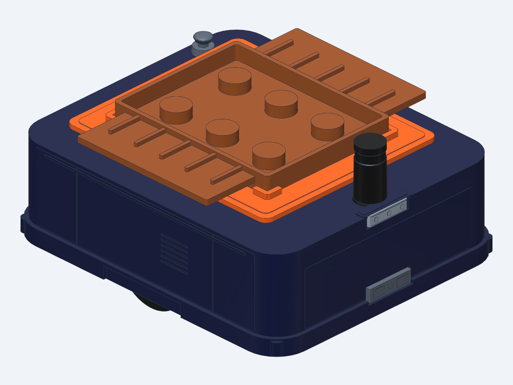
*Hình 4.1: Mô hình URDF/Xacro sau khi xuất Binary STL từ OpenSCAD và gán đa vật liệu (`<material>`) cho từng cụm chi tiết con.*

---

### 4.4. Tự động hóa xuất hàng loạt Binary STL bằng Bash Script (`export_all_stl.sh`)

Thay vì mở từng file `.scad` trong giao diện đồ họa rồi bấm `F6` $\rightarrow$ `F7` thủ công (dễ quên hoặc xuất nhầm định dạng ASCII STL dung lượng lớn), hãy dùng dòng lệnh OpenSCAD CLI với tùy chọn `--export-format binstl`:

```bash
#!/usr/bin/env bash
set -e

OPENSCAD="/snap/bin/openscad-nightly" # Hoặc "openscad"
mkdir -p meshes

export_stl() {
    input_file="$1"
    output_file="$2"
    echo "Dang xuat Binary STL: $input_file -> meshes/$output_file"

    "$OPENSCAD" \
        --export-format binstl \
        -o "meshes/$output_file" \
        "$input_file"
}

# Xuất các cụm chi tiết của Robot:
export_stl export_chassis.scad            chassis_visual.stl
export_stl export_left_wheel_tire.scad    left_wheel_tire_visual.stl
export_stl export_left_wheel_hub.scad     left_wheel_hub_visual.stl
export_stl export_right_wheel_tire.scad   right_wheel_tire_visual.stl
export_stl export_right_wheel_hub.scad    right_wheel_hub_visual.stl
export_stl export_lift_fixed.scad         lift_fixed_visual.stl
export_stl export_lift_platform_base.scad lift_platform_base_visual.stl
export_stl export_lidar_pedestal.scad     lidar_pedestal_visual.stl
export_stl export_lidar_unit.scad         lidar_unit_visual.stl

# Copy toàn bộ file STL sang thư mục meshes của ROS 2 package:
cp meshes/*.stl ../src/factory_delivery_amr_description/meshes/
```

**Cách chạy trong dự án này (từ thư mục gốc repository):**
```bash
cd cad
./export_all_stl.sh
cp meshes/*.stl ../src/factory_delivery_amr_description/meshes/
cd ..
```

---

### 4.5. Quy đổi Đơn vị từ OpenSCAD (`mm`, `deg`) sang URDF (`m`, `rad`, `kg`)

ROS 2 và URDF bắt buộc sử dụng hệ đơn vị đo lường quốc tế **SI**. Bạn phải tuân thủ bảng quy đổi sau khi viết file `.urdf` / `.xacro`:

| Đại lượng | Đơn vị trong OpenSCAD | Đơn vị trong URDF / ROS 2 | Công thức chuyển đổi sang URDF |
| :--- | :---: | :---: | :--- |
| **Kích thước Mesh STL** | `mm` | `m` | Thêm thuộc tính `scale="0.001 0.001 0.001"` vào mọi thẻ `<mesh>` |
| **Tọa độ vị trí (`xyz`)** | `mm` | `m` | Chia cho `1000` (Ví dụ: `[368, 0, 390]` mm $\rightarrow$ `xyz="0.368 0 0.390"`) |
| **Góc xoay (`rpy`)** | Độ (`deg`) | Radian (`rad`) | $\text{rad} = \text{deg} \times \frac{\pi}{180}$ (Ví dụ: $90^\circ \rightarrow \text{\${pi/2}} \approx 1.570796$, $180^\circ \rightarrow \text{\${pi}}$) |
| **Khối lượng (`mass`)** | *(Không có)* | Kilôgam (`kg`) | Khai báo trong `<mass value="..."/>` |
| **Quán tính (`inertia`)** | *(Không có)* | $\text{kg}\cdot\text{m}^2$ | Tính theo công thức hình học bên dưới |

---

### 4.6. Thiết lập `<visual>`, `<collision>` tối ưu và công thức tính `<inertial>`

#### 1. Tại sao không nên dùng file `.stl` cho thẻ `<collision>`?
Mesh `.stl` xuất từ OpenSCAD có hàng nghìn tam giác nhỏ. Nếu đưa vào `<collision>`, bộ giải vật lý ODE/Bullet/DART của Gazebo phải kiểm tra va chạm trên từng tam giác mỗi mili-giây, gây giảm FPS và làm bánh xe bị rung giật.
**Giải pháp tối ưu:**
- **`<visual>`:** Dùng `<mesh filename="package://.../meshes/*.stl" scale="0.001 0.001 0.001"/>`.
- **`<collision>`:** Dùng các hình khối nguyên thủy chuẩn toán học:
  - Bánh xe chủ động: Dùng `<cylinder radius="0.110" length="0.060"/>` xoay `<origin rpy="${pi/2} 0 0"/>`.
  - Bánh xe tự lựa (Caster): Dùng `<sphere radius="0.035"/>` đặt tâm ở `Z = 0.035` m (để đáy cầu chạm mặt sàn `Z = 0.000` m) kết hợp ma sát bằng `0.001`.
  - Thân xe / Bàn nâng / Khay hàng: Dùng `<box size="x y z"/>`.

#### 2. Bảng công thức tính Ma trận Mô-men Quán tính (`<inertia>`) chuẩn cho URDF

Mọi Link tham gia mô phỏng động lực học trong Gazebo **bắt buộc** phải có thẻ `<inertial>` hợp lệ (các phần tử đường chéo chính $I_{xx}, I_{yy}, I_{zz} > 0$ và thỏa mãn bất đẳng thức tam giác). Với các vật thể đối xứng có tâm khối lượng trùng với tâm hình học ($I_{xy} = I_{xz} = I_{yz} = 0$):

1. **Khối hộp chữ nhật đặc (Solid Box)** kích thước $(x, y, z)\text{ [m]}$, khối lượng $m\text{ [kg]}$:
   $$I_{xx} = \frac{1}{12} m (y^2 + z^2), \quad I_{yy} = \frac{1}{12} m (x^2 + z^2), \quad I_{zz} = \frac{1}{12} m (x^2 + y^2)$$

2. **Khối trụ đặc (Solid Cylinder — Bánh xe)** bán kính $r\text{ [m]}$, bề dày $h\text{ [m]}$, khối lượng $m\text{ [kg]}$:
   - Nếu trục quay của bánh xe nằm dọc theo **trục Y** (như bánh xe robot vi sai):
     $$I_{xx} = I_{zz} = \frac{1}{12} m (3r^2 + h^2), \quad I_{yy} = \frac{1}{2} m r^2$$
   - *(Ví dụ bánh xe AMR: $m = 2.2\text{ kg}, r = 0.11\text{ m}, h = 0.06\text{ m} \Rightarrow I_{yy} = 0.5 \times 2.2 \times 0.11^2 = 0.01331\text{ kg}\cdot\text{m}^2$, $I_{xx} = I_{zz} = 0.007315\text{ kg}\cdot\text{m}^2$).*

3. **Khối cầu đặc (Solid Sphere — Bánh Caster)** bán kính $r\text{ [m]}$, khối lượng $m\text{ [kg]}$:
   $$I_{xx} = I_{yy} = I_{zz} = \frac{2}{5} m r^2$$

**Macro Xacro tự động tính `<inertial>` tiện dụng:**
```xml
<!-- Macro quán tính khối hộp đặc -->
<xacro:macro name="box_inertia" params="m x y z xyz='0 0 0' rpy='0 0 0'">
  <inertial>
    <origin xyz="${xyz}" rpy="${rpy}"/>
    <mass value="${m}"/>
    <inertia ixx="${(m/12.0) * (y*y + z*z)}" ixy="0.0" ixz="0.0"
             iyy="${(m/12.0) * (x*x + z*z)}" iyz="0.0"
             izz="${(m/12.0) * (x*x + y*y)}"/>
  </inertial>
</xacro:macro>

<!-- Macro quán tính bánh xe hình trụ quay quanh trục Y -->
<xacro:macro name="wheel_y_inertia" params="m r h">
  <inertial>
    <origin xyz="0 0 0" rpy="0 0 0"/>
    <mass value="${m}"/>
    <inertia ixx="${(m/12.0) * (3*r*r + h*h)}" ixy="0.0" ixz="0.0"
             iyy="${0.5 * m * r * r}"          iyz="0.0"
             izz="${(m/12.0) * (3*r*r + h*h)}"/>
  </inertial>
</xacro:macro>
```

---

### 4.7. Cấu hình các loại Khớp (`<joint>`): Fixed, Continuous, Revolute, Prismatic & Mimic

Trong URDF có 4 loại khớp cơ bản thường dùng khi chuyển từ OpenSCAD sang:

```xml
<!-- 1. KHỚP CỐ ĐỊNH (fixed): Dùng cho khung gầm, vỏ máy, cảm biến LiDAR, Camera, IMU -->
<joint name="camera_joint" type="fixed">
  <parent link="base_link"/>
  <child link="camera_link"/>
  <origin xyz="0.415 0 0.285" rpy="0 0 0"/>
</joint>

<!-- 2. KHỚP QUAY LIÊN TỤC KHÔNG GIỚI HẠN GÓC (continuous): Dùng cho bánh xe chủ động -->
<joint name="left_wheel_joint" type="continuous">
  <parent link="base_link"/>
  <child link="left_wheel_link"/>
  <origin xyz="0 0.310 0.110" rpy="0 0 0"/>
  <axis xyz="0 1 0"/> <!-- Quay quanh trục Y -->
  <limit effort="80.0" velocity="20.0"/>
  <dynamics damping="0.1" friction="0.05"/>
</joint>

<!-- 3. KHỚP TRƯỢT TỊNH TIẾN (prismatic): Dùng cho bàn nâng thủy lực / trục vít me -->
<joint name="lift_joint" type="prismatic">
  <parent link="base_link"/>
  <child link="lift_platform_link"/>
  <origin xyz="-0.015 0 0.330" rpy="0 0 0"/>
  <axis xyz="0 0 1"/> <!-- Trượt thẳng đứng dọc trục +Z từ 0m đến 0.290m -->
  <limit lower="0.0" upper="0.290" effort="1500.0" velocity="0.25"/>
  <dynamics damping="40.0" friction="5.0"/>
</joint>

<!-- 4. KHỚP QUAY CÓ GIỚI HẠN GÓC (revolute) KẾT HỢP <mimic>: Dùng cho cơ cấu thanh cắt kéo -->
<joint name="scissor_left_a_joint" type="revolute">
  <parent link="base_link"/>
  <child link="scissor_left_a_link"/>
  <origin xyz="-0.150 0.112 0.268" rpy="0 0 0"/>
  <axis xyz="0 -1 0"/>
  <limit lower="0.154" upper="0.890" effort="300.0" velocity="1.5"/>
  <!-- Tự động xoay thanh cắt kéo theo độ cao của lift_joint trong RViz2:
       angle = lift_joint * multiplier + offset -->
  <mimic joint="lift_joint" multiplier="2.538" offset="0.154"/>
</joint>
```

| Mô hình URDF khi hạ bàn nâng (`lift_joint = 0.000 m`) | Mô hình URDF khi nâng bàn nâng & thanh cắt kéo `<mimic>` (`lift_joint = 0.290 m`) |
| :---: | :---: |
|  | 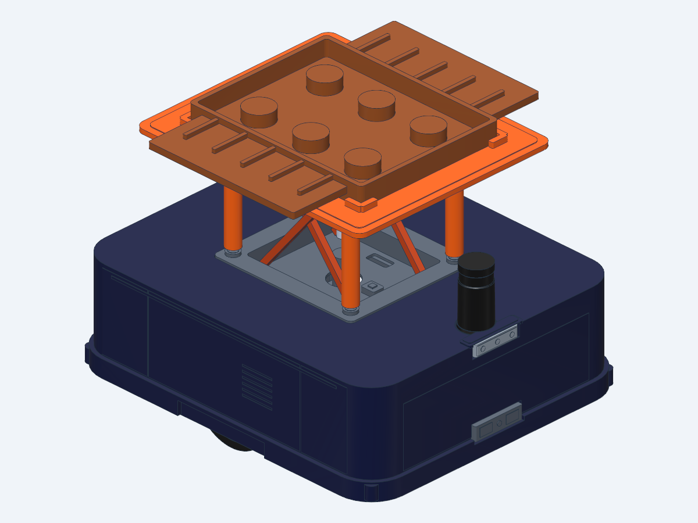 |
*Hình 4.2: Đối chiếu mô hình URDF ở trạng thái hạ thấp và trạng thái nâng tối đa với 4 thanh cắt kéo tự động đồng bộ qua thẻ `<mimic>`.*

---

### 4.8. Tích hợp Gazebo Physics (Ma sát, Động cơ vi sai, Bàn nâng, Cảm biến)

Để Robot hoạt động thực tế trong **Gazebo (Ignition / Gazebo Fortress)**, cần bổ sung các thẻ `<gazebo>` vào cuối file `.urdf.xacro`:

#### 1. Cấu hình Ma sát lốp xe chủ động ($\mu = 1.2$) và Bánh xe tự lựa Caster ($\mu = 0.001$)
```xml
<!-- Bánh chủ động cần ma sát lớn để bám đường kéo tải 20kg -->
<gazebo reference="left_wheel_link">
  <mu1>1.2</mu1>
  <mu2>1.2</mu2>
</gazebo>
<gazebo reference="right_wheel_link">
  <mu1>1.2</mu1>
  <mu2>1.2</mu2>
</gazebo>

<!-- 4 bánh caster dùng hình cầu ma sát cực nhỏ để trượt mượt không gây kẹt khi quay tại chỗ -->
<gazebo reference="caster_front_left_link">
  <mu1>0.001</mu1>
  <mu2>0.001</mu2>
  <kp>1000000.0</kp>
  <kd>10.0</kd>
</gazebo>
```

#### 2. Plugin Điều khiển Truyền động Vi sai (`DiffDrive`) & Xuất trạng thái khớp (`JointStatePublisher`)
```xml
<gazebo>
  <plugin filename="ignition-gazebo-diff-drive-system"
          name="ignition::gazebo::systems::DiffDrive">
    <left_joint>left_wheel_joint</left_joint>
    <right_joint>right_wheel_joint</right_joint>
    <!-- Phải khớp chính xác với thông số trong OpenSCAD:
         drive_wheel_track = 620 mm -> 0.620 m
         drive_wheel_radius = 110 mm -> 0.110 m -->
    <wheel_separation>0.620</wheel_separation>
    <wheel_radius>0.110</wheel_radius>
    <topic>/cmd_vel</topic>
    <odom_topic>/odom</odom_topic>
    <tf_topic>/tf</tf_topic>
    <frame_id>odom</frame_id>
    <child_frame_id>base_footprint</child_frame_id>
  </plugin>

  <plugin filename="ignition-gazebo-joint-state-publisher-system"
          name="ignition::gazebo::systems::JointStatePublisher">
    <topic>/joint_states</topic>
    <joint_name>left_wheel_joint</joint_name>
    <joint_name>right_wheel_joint</joint_name>
    <joint_name>lift_joint</joint_name>
  </plugin>
</gazebo>
```

#### 3. Plugin Điều khiển vị trí Bàn nâng PID (`JointPositionController`)
```xml
<gazebo>
  <plugin filename="ignition-gazebo-joint-position-controller-system"
          name="ignition::gazebo::systems::JointPositionController">
    <joint_name>lift_joint</joint_name>
    <topic>/lift_position</topic>
    <p_gain>5000.0</p_gain>
    <i_gain>10.0</i_gain>
    <d_gain>150.0</d_gain>
  </plugin>
</gazebo>
```

---

### 4.9. Kiểm tra, Build và Chạy mô phỏng trong ROS 2 (RViz2 & Gazebo)

Sau khi hoàn thiện các file `.scad` và `.urdf.xacro`, bạn thực hiện quy trình 4 bước sau trên Terminal (mở tại thư mục gốc của repository) để kiểm chứng toàn bộ hệ thống:

#### Bước 1: Xuất toàn bộ Mesh STL từ OpenSCAD và cập nhật vào ROS 2 Package
```bash
cd cad
./export_all_stl.sh
cp meshes/*.stl ../src/factory_delivery_amr_description/meshes/
cd ..
```

#### Bước 2: Kiểm tra tính hợp lệ của cú pháp Xacro / URDF và Cây khung tọa độ (TF Tree)
```bash
# Biên dịch thử file .xacro ra .urdf thuần và kiểm tra lỗi bằng check_urdf:
xacro src/factory_delivery_amr_description/urdf/factory_delivery_amr.urdf.xacro > /tmp/test_amr.urdf
check_urdf /tmp/test_amr.urdf

# (Tùy chọn) Xuất sơ đồ cây động học ra file PDF để kiểm tra các khớp nối:
urdf_to_graphviz /tmp/test_amr.urdf /tmp/amr_tree
```

#### Bước 3: Biên dịch Workspace ROS 2 bằng `colcon`
```bash
# Chạy tại thư mục gốc repository:
colcon build --packages-select factory_delivery_amr_description --symlink-install
source install/setup.bash
```

#### Bước 4: Khởi chạy hiển thị trên RViz2 và mô phỏng vật lý trên Gazebo
```bash
# 1. Xem mô hình 3D trên RViz2 kèm thanh trượt điều chỉnh các khớp (joint_state_publisher_gui):
source install/setup.bash
ros2 launch factory_delivery_amr_description display.launch.py

# 2. Chạy mô phỏng vật lý đầy đủ trong nhà máy với Gazebo Fortress + RViz2:
source install/setup.bash
ros2 launch factory_delivery_amr_description gazebo.launch.py

# 3. Mở một Terminal khác (tại thư mục gốc) để điều khiển Robot di chuyển và nâng/hạ bàn nâng bằng bàn phím:
source install/setup.bash
ros2 run factory_delivery_amr_description amr_keyboard_teleop.py
```

---

## TÓM TẮT CHECKLIST NHANH KHI CHẾ TẠO ROBOT OPENSCAD $\rightarrow$ URDF

1. **[ ] Hệ tọa độ:** Thiết kế trong OpenSCAD theo chuẩn `+X` (Tiến), `+Y` (Trái), `+Z` (Lên), mặt sàn tại `Z = 0`.
2. **[ ] Boolean CSG sạch:** Luôn cộng thêm `eps = 0.05` khi dùng `difference()` để tránh lỗi trùng mặt đa giác.
3. **[ ] Gốc tọa độ STL (`Origin Alignment`):** Mọi khớp động (`wheel`, `lift`, `scissor`) và cảm biến (`lidar`, `camera`) khi xuất ra STL phải được `translate([-X0, -Y0, -Z0])` về gốc `[0, 0, 0]`, sau đó khai báo `<origin xyz="X0/1000 Y0/1000 Z0/1000"/>` trong `<joint>` của URDF.
4. **[ ] Đa màu sắc:** Tách các chi tiết khác màu thuộc cùng 1 Link thành các file `.stl` riêng và ghép bằng nhiều thẻ `<visual>` trong cùng 1 `<link>`.
5. **[ ] Định dạng xuất:** Luôn xuất **Binary STL** (`--export-format binstl`) và thêm `scale="0.001 0.001 0.001"` trong URDF.
6. **[ ] Va chạm & Quán tính:** Dùng hình khối cơ bản (`<cylinder>`, `<sphere>`, `<box>`) cho `<collision>` và tính chính xác `<inertial>` theo công thức khối lượng - hình học để Gazebo mô phỏng ổn định.


