> **Phạm vi:** báo cáo mô hình số và lý thuyết điều khiển; chưa phải báo cáo thử nghiệm Gazebo/robot thật.


# 1. Mục tiêu, phạm vi và quy ước dữ liệu

Tài liệu phục vụ nhiệm vụ được phân công: tổng hợp cơ sở toán học của robot di động truyền động vi sai, đưa ra mô hình động lực học ở mức đủ xây dựng bộ điều khiển tốc độ bánh xe, giải thích PI/PID, và xác định cách kiểm tra bằng mô phỏng.

Nội dung được xây dựng cho bài toán Factory Delivery AMR: robot nhận khay từ kho A, giao đến B → C → D; tải hữu ích **20 kg**, hành lang **1,2 m**, vận tốc yêu cầu **≥ 1,2 m/s**, sai số dừng **< 30 mm** theo tiêu chí cần chốt và thời gian hoạt động **≥ 4 giờ**. Các con số này là yêu cầu ban đầu từ khách hàng, không phải kết quả robot đã đạt.

**Tình trạng liên kết mã nguồn:** repository nhóm: [HoangAnh301194/Industrial_AMR_Robot](https://github.com/HoangAnh301194/Industrial_AMR_Robot). Chưa đối chiếu được nội dung riêng của repository với các giá trị giả định trong tài liệu này. Trước khi nhập cấu hình vào URDF / Gazebo, nhóm phải lấy `wheel_radius`, `wheel_separation`, khối lượng và quán tính trực tiếp từ model hiện hành.

| Nhóm dữ liệu | Đại lượng | Giá trị | Trạng thái |
|:--|:--|--:|:--|
| Khách hàng | Tải hữu ích | 20 kg | Đầu vào đã nêu |
| Khách hàng | Hành lang | 1,20 m | Đầu vào đã nêu |
| Khách hàng | Vận tốc tối thiểu yêu cầu | 1,20 m/s | Cần chốt điều kiện đo |
| Khách hàng | Sai số dừng | < 30 mm | Cần chốt phép đo nghiệm thu |
| Khách hàng | Thời gian hoạt động | ≥ 4 giờ | Cần chốt duty cycle |
| Minh họa | Kích thước bao hình | 0,70 × 0,55 m | Đề xuất sơ bộ |
| Minh họa | Khối lượng thân + thiết bị | 55 kg | Giả định, chưa cân đo |
| Minh họa | Tổng khối lượng khi tải | 75 kg | 55 + 20 kg |
| Minh họa | Bán kính bánh chủ động, $r$ | 0,08 m | Giả định bánh Ø160 mm |
| Minh họa | Khoảng cách tâm bánh, $b$ | 0,45 m | **Giả định**, cần đọc URDF |
| Minh họa | Gia tốc thiết kế, $a$ | 0,80 m/s² | Giả định để tính chọn |
| Minh họa | Hệ số cản lăn, $c_{rr}$ | 0,025 | Giả định; phụ thuộc sàn/bánh |
| Minh họa | Hệ số dự phòng lực, $k_s$ | 1,5 | Giả định thiết kế |

Tất cả phương trình sử dụng hệ SI. Trục $x$ của robot hướng về phía trước, $y$ sang trái và $z$ hướng lên; $\theta$ dương theo chiều ngược kim đồng hồ. Hai bánh chủ động được ký hiệu **trái (L)** và **phải (R)**; bánh caster chỉ đỡ tải và không tạo lực chủ động lý tưởng. Robot có thể có 4 bánh *vật lý* (2 chủ động + 2 caster), nhưng mô hình động học vi sai chỉ cần hai bánh chủ động.

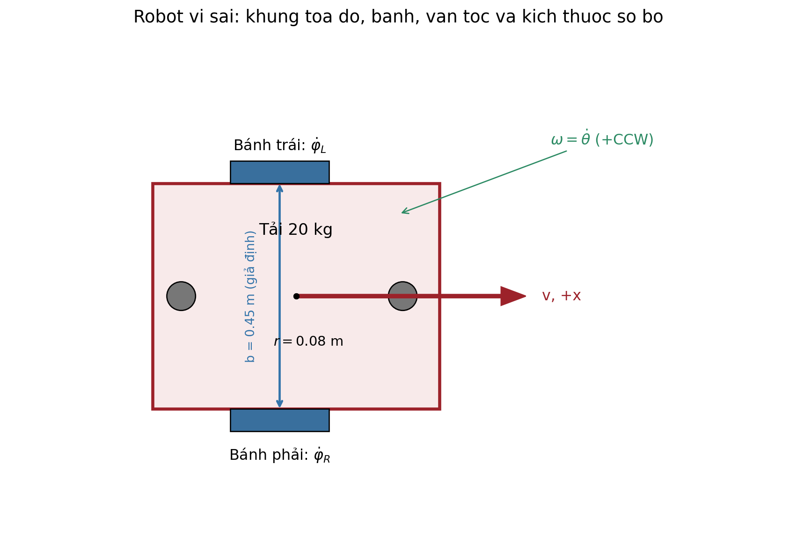

# 2. Động học robot vi sai hai bánh

## 2.1. Các giả thiết mô hình

Nền phẳng, tiếp xúc bánh–sàn không trượt thuần; bánh trái và phải có cùng bán kính hiệu dụng $r$; tâm robot là trung điểm hai bánh chủ động; tốc độ của bánh có thể đo bằng encoder. Chuyển động ngang tức thời trong hệ trục robot được coi bằng 0 (ràng buộc không trượt ngang). Khi có trượt bánh, sàn dốc, tải lệch hoặc bánh caster bị rung, mô hình này chỉ là xấp xỉ.

## 2.2. Động học thuận

Ký hiệu $\dot{\varphi}_R,\dot{\varphi}_L$ là vận tốc góc bánh phải/trái (rad/s), $v$ là vận tốc tiến và $\omega=\dot{\theta}$ là vận tốc quay thân (rad/s):

$$
v=\frac{r}{2}(\dot{\varphi}_R+\dot{\varphi}_L),\qquad
\omega=\frac{r}{b}(\dot{\varphi}_R-\dot{\varphi}_L).
$$

Dạng ma trận, với thứ tự hai bánh $[R,L]^T$:

$$
\begin{bmatrix}v\\\omega\end{bmatrix}=
\begin{bmatrix}r/2&r/2\\r/b&-r/b\end{bmatrix}
\begin{bmatrix}\dot{\varphi}_R\\\dot{\varphi}_L\end{bmatrix}.
$$

Chuyển từ vận tốc trong hệ robot sang đạo hàm tư thế trong hệ bản đồ:

$$
\dot{x}=v\cos\theta,\qquad
\dot{y}=v\sin\theta,\qquad
\dot{\theta}=\omega.
$$

**Các trường hợp quan trọng:** $\dot{\varphi}_R=\dot{\varphi}_L$ → đi thẳng; $\dot{\varphi}_R=-\dot{\varphi}_L$ → quay gần như tại tâm; hai tốc độ khác nhau → chuyển động cong. Nếu $\omega\neq0$, bán kính cong quỹ đạo của tâm là $R_c=v/\omega$.

## 2.3. Động học nghịch

Cho lệnh tốc độ thân từ điều hướng $v^*,\omega^*$, tính tốc độ đặt của hai bánh:

$$
\boxed{\dot{\varphi}_R^*=\frac{v^*+\tfrac b2\omega^*}{r}},\qquad
\boxed{\dot{\varphi}_L^*=\frac{v^*-\tfrac b2\omega^*}{r}}.
$$

Ví dụ với $r=0,08$ m, $b=0,45$ m và lệnh đi thẳng $v^*=1,20$ m/s, $\omega^*=0$: cả hai bánh cần đạt $15$ rad/s, tương đương $15\times60/(2\pi)=143,24$ vòng/phút. Khi $v^*=0,60$ m/s và $\omega^*=0,50$ rad/s, ta có $\dot{\varphi}_R^*=8,906$ rad/s và $\dot{\varphi}_L^*=6,094$ rad/s, cho bán kính cong lý thuyết $1,20$ m. Nếu tỷ số truyền là $i=10$, tốc độ motor khi xe chạy thẳng 1,2 m/s xấp xỉ $1432,4$ vòng/phút (bỏ qua trượt bánh).

## 2.4. Odometry và phép biến đổi TF

Encoder cho biết độ thay đổi góc bánh $\Delta\varphi_R,\Delta\varphi_L$. Từ đó:

$$
\Delta s=\frac r2(\Delta\varphi_R+\Delta\varphi_L),\qquad
\Delta\theta=\frac rb(\Delta\varphi_R-\Delta\varphi_L).
$$

Cập nhật tư thế bằng góc giữa bước:

$$
x_{k+1}=x_k+\Delta s\cos(\theta_k+\Delta\theta/2),\qquad
 y_{k+1}=y_k+\Delta s\sin(\theta_k+\Delta\theta/2),\qquad
\theta_{k+1}=\theta_k+\Delta\theta.
$$

Chuỗi TF dự kiến được chia theo cây như sau:

```text
map -> odom -> base_link
base_link -> laser_link
base_link -> imu_link
base_link -> wheel_left_link
base_link -> wheel_right_link
```

`map→odom` thường do hệ định vị (SLAM/AMCL) phát; `odom→base_link` chỉ do **một** nguồn odometry/EKF phát. Không để plugin Gazebo và EKF cùng phát một transform. Khi sai bán kính bánh hoặc khoảng cách hai bánh trong URDF, odometry sẽ sai tỷ lệ quãng đường hoặc góc quay.

# 3. Động lực học robot vi sai

## 3.1. Cân bằng lực theo phương chuyển động

Khác động học (mô tả cách di chuyển), động lực học xét lực, mô-men, khối lượng, gia tốc, ma sát và công suất. Trong mô hình phẳng đơn giản:

$$
m\dot{v}=\frac{\tau_{w,R}+\tau_{w,L}}{r}-F_{rr}-F_d-F_g,
$$

với $\tau_{w,R},\tau_{w,L}$ là mô-men **tại trục bánh chủ động**. Nếu mô-men được tính tại trục motor ($\tau_m$), cần quy đổi qua hộp số: $\tau_w=\eta_g i\tau_m$ (với $i$ là tỷ số truyền và $\eta_g$ là hiệu suất). Như vậy lực kéo ở bánh là $(\tau_{w,R}+\tau_{w,L})/r$. Cần nhất quán định nghĩa khi viết code và chọn động cơ. $F_{rr}\approx c_{rr}mg$ là lực cản lăn trên sàn ngang; $F_d$ gồm cản môi trường và tải phụ; $F_g=mg\sin\alpha$ là thành phần trọng lực khi sàn dốc góc $\alpha$.

Theo chuyển động quay thân quanh trục $z$:

$$
I_z\dot{\omega}=\frac{b}{2r}\big(\tau_{w,R}-\tau_{w,L}\big)-M_{\rm res},
$$

trong đó $\tau_{w,R},\tau_{w,L}$ là mô-men bánh thực tế, $M_{\rm res}$ là mô-men cản quay. Công thức là xấp xỉ cho robot cứng, không xét đầy đủ chuyển tải, rung caster và biến dạng bánh. Mỗi bánh phải thỏa giới hạn bám đường; mô-men lớn không có nghĩa có thể truyền hết lực xuống sàn.

## 3.2. Mô hình quán tính ghép hai bánh

Với $\dot{\varphi}=[\dot{\varphi}_R,\dot{\varphi}_L]^T$, khối lượng tổng $m$, mô-men quán tính quay thân $I_z$, quán tính quay mỗi bánh $J_w$ và bỏ qua trượt bánh:

$$
T=\frac12 mv^2+\frac12 I_z\omega^2+
\frac12J_w(\dot{\varphi}_R^2+\dot{\varphi}_L^2).
$$

Suy ra ma trận quán tính quy đổi đến trục bánh:

$$
\mathbf M_w =
\begin{bmatrix}
\frac{mr^2}{4}+\frac{I_zr^2}{b^2}+J_w &\frac{mr^2}{4}-\frac{I_zr^2}{b^2}\\
\frac{mr^2}{4}-\frac{I_zr^2}{b^2}&\frac{mr^2}{4}+\frac{I_zr^2}{b^2}+J_w
\end{bmatrix}.
$$

Phương trình rút gọn:

$$
\mathbf M_w\ddot{\boldsymbol\varphi}
=\begin{bmatrix}\tau_{w,R}\\\tau_{w,L}\end{bmatrix}
-\mathbf B_w\dot{\boldsymbol\varphi}
-\boldsymbol\tau_{\rm roll}.
$$

Quán tính $I_z$ có thể **ước lượng sơ bộ** bằng hình hộp đồng nhất $I_z\approx m(L^2+W^2)/12$. Với $m=75$ kg, $L=0,70$ m, $W=0,55$ m cho $I_z\approx4,95$ kg·m². Đây chỉ là giả định phân bố khối lượng, không thay thế trị số quán tính trong URDF/CAD có tải. Muốn mô phỏng motor đầy đủ, phải thêm đặc tính điện–cơ, hộp số, hiệu suất, quán tính rotor, mạch điều khiển và giới hạn dòng.

## 3.3. Tính toán lực kéo và mô-men để chọn motor

Giả sử $m=75$ kg, $a=0,80$ m/s², $c_{rr}=0,025$, $g=9,81$ m/s², đường phẳng:

$$
F_{rr}=c_{rr}mg=0,025\times75\times9,81=18,39\;\text{N}.
$$

$$
F_a=ma=75\times0,80=60,00\;\text{N}.
$$

$$
F_{\rm base}=F_{rr}+F_a=78,39\;\text{N}.
$$

Với hệ số dự phòng minh họa $k_s=1,5$:

$$
\boxed{F_{\rm design}=1,5\times78,39=117,59\;\text{N}}.
$$

Hai bánh chủ động chia lực đều trong giả định:

$$
\boxed{\tau_{w,\rm design} =\frac{F_{\rm design}r}{2}
=\frac{117,59\times0,08}{2}=4,70\;\text{N·m/bánh}}.
$$

Nếu chọn hộp số tỷ số $i=10$ và hiệu suất giả định $\eta_g=0,85$ thì mô-men motor cần có tại điều kiện này:

$$
\tau_{m,\rm design}=\frac{\tau_{w,\rm design}}{i\eta_g}
=\frac{4,70}{10\times0,85}\approx0,553\;\text{N·m/motor}.
$$

Công suất cơ học tối thiểu ứng với lực kéo thiết kế và tốc độ 1,2 m/s là $P_{w}=F_{\rm design}v\approx141,1$ W cho cả hai bánh; tính tổn hao hộp số $P_m\approx166,0$ W cho cả hai motor. **Không được suy ra chỉ cần motor 83 W mỗi bên**: cần xem cả biểu đồ mô-men–tốc độ, mô-men liên tục/đỉnh, tản nhiệt, gia tốc, dốc sàn, tải lệch và chu kỳ vận hành. Phương án **2 BLDC 48 V–250 W** ở báo cáo trước chỉ là ứng viên; chưa có datasheet để chốt.

## 3.4. Kiểm tra tải lên bánh và năng lượng

Với 2 bánh chủ động + 2 caster, tải tĩnh trung bình nếu phân phối đều là $75/4=18,75$ kg/bánh. **Không được dùng phép chia bốn làm cam kết tải trên từng bánh**: tải thật phụ thuộc trọng tâm, vị trí tâm bánh, độ cứng khung và gia tốc. Cần thiết lập sơ đồ cân bằng lực theo hình học thật để tính tải cực đại và chọn ổ bi/caster.

Đối với pin ứng viên $51,2$ V–$50$ Ah, năng lượng danh định $2560$ Wh. Nếu dùng giả định DoD hữu dụng $80\%$ và hiệu suất năng lượng $90\%$ thì năng lượng cấp cho hệ thống là $1843,2$ Wh. Với công suất trung bình 350 W, thời lượng dự báo $5,27$ giờ; với 500 W chỉ còn $3,69$ giờ. Để đạt 4 giờ dưới các giả định trên, công suất trung bình phải không vượt khoảng $460,8$ W. **Các số này cần xác nhận bằng profile công suất thực, chu kỳ giao hàng và kiểm tra sạc**, không phải kết quả thử nghiệm.

# 4. Bộ điều khiển PID cho hệ bánh vi sai

## 4.1. Cấu trúc điều khiển đề xuất

Trong ROS 2, Nav2 gửi lệnh $v^*,\omega^*$; khối động học nghịch tính ra $\dot\varphi^*_R,\dot\varphi^*_L$; mỗi bánh có bộ điều tốc riêng nhận encoder để bám tốc độ; trạng thái ước lượng quay về odometry/TF và hệ định vị. Bộ điều khiển an toàn (nếu cần theo đánh giá rủi ro) là lớp độc lập, không trông cậy vào PID hoặc thuật toán điều hướng. Xem tài liệu chính thức [diff_drive_controller cho ROS 2 Jazzy](https://control.ros.org/jazzy/doc/ros2_controllers/diff_drive_controller/doc/userdoc.html).

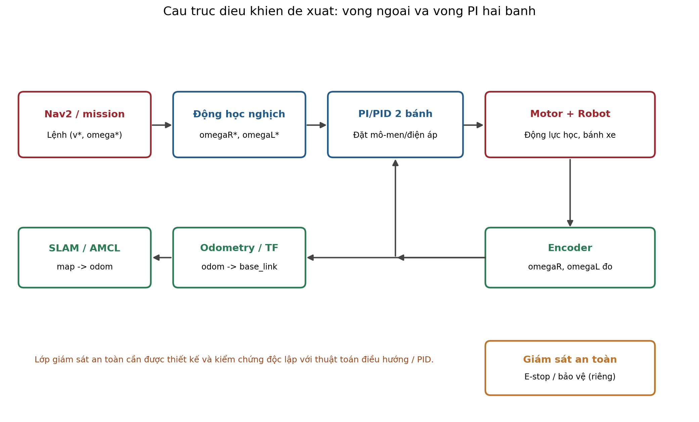

**Phân biệt ba mức điều khiển:** (1) vòng nhiệm vụ/định vị/điều hướng quyết định đi đâu; (2) vòng tốc độ thân $v,\omega$ hoặc lệnh vận tốc bánh quyết định chuyển động; (3) vòng tốc độ motor/bánh dùng PI/PID bám setpoint. PID điều tốc **không tự bảo đảm** sai số dừng 30 mm; docking có thể cần điều khiển vị trí tinh chỉnh, marker và phép đo tại trạm.

## 4.2. Luật PID cho từng bánh

Đặt $e_i(t)=\dot\varphi^*_i(t)-\dot\varphi_i(t)$, với $i\in\{L,R\}$. Bộ điều khiển PID liên tục:

$$
u_i(t)=K_{p,i}e_i(t)+K_{i,i}\int_0^t e_i(\tau)\,d\tau
+K_{d,i}\frac{de_i(t)}{dt}.
$$

Đầu ra $u$ có thể là yêu cầu mô-men, dòng điện hoặc PWM **tùy bộ driver**. Vì vậy các hệ số $K_p,K_i,K_d$ có đơn vị và giá trị khác nhau giữa các giao diện; tuyệt đối không chép một bộ tham số bất kỳ sang phần cứng khác. Với bài toán điều tốc, PI thường là điểm bắt đầu hợp lý; thành phần D không bắt buộc vì đạo hàm của encoder nhiễu.

Dạng rời rạc ở chu kỳ $T_s$:

$$
I_i[k]=I_i[k-1]+T_s e_i[k],\qquad
D_i[k]\approx\frac{e_i[k]-e_i[k-1]}{T_s},
$$

$$
u_i[k]=K_p e_i[k]+K_i I_i[k]+K_d D_i[k],\qquad
u_{i,\rm out}[k]=\operatorname{sat}(u_i[k],u_{\min},u_{\max}).
$$

Nên lọc đạo hàm hoặc dùng đạo hàm của giá trị đo để tránh “giật” khi đổi setpoint. Bắt buộc quản lý bão hòa và **anti-windup** (khóa tích phân hoặc back-calculation khi actuator bão hòa). Thêm giới hạn gia tốc / jerk của lệnh vận tốc, timeout mất lệnh, xử lý encoder lỗi và chính sách dừng an toàn theo kiến trúc điều khiển được phê duyệt.

## 4.3. Trình tự hiệu chỉnh PID

1. Kiểm tra dấu encoder, dấu lệnh motor, giới hạn bánh, độ phân giải encoder, đúng tỷ số truyền và cách tính rad/s. Đảm bảo không có **hai vòng điều khiển tốc độ cùng tranh quyền**: driver motor có thể đã tích hợp PID/FOC, ROS 2 chỉ cần phát vận tốc đặt.
2. Thực hiện mô hình hóa một bánh hoặc thử vận tốc thấp trong môi trường thử nghiệm an toàn, đặt $K_i=K_d=0$, tăng $K_p$ từ nhỏ để kiểm tra phản ứng; không áp dụng bộ PID chưa hiệu chỉnh trực tiếp cho robot tải nặng trong khu vực có người.
3. Bổ sung $K_i$ từ nhỏ để giảm sai số xác lập khi có tải; hạn chế tích phân khi bão hòa hoặc mất tiếp xúc mặt sàn.
4. Chỉ bổ sung $K_d$ nếu có nhu cầu điều chỉnh quá độ và dữ liệu tốc độ đủ sạch; lọc tín hiệu đạo hàm.
5. Kiểm tra độc lập bánh trái/bánh phải, cả hai bánh cùng chạy, vận tốc tiến–quay kết hợp, tải 20 kg, quãng dừng và ảnh hưởng khi giảm điện áp pin. Sau đó mới xem xét điều khiển docking và navigation toàn hệ thống.

**Không có cơ sở để tuyên bố bộ $K_p,K_i,K_d$ cuối cùng nếu chưa có thông số điện–cơ và log thử nghiệm.** Các giá trị trong script Python kèm theo chỉ dùng tái lập ví dụ số, không dùng như cấu hình sản phẩm.

## 4.4. Demo mô phỏng số có thể tái lập

Script [`../examples/simulate_diff_drive_pi.py`](../examples/simulate_diff_drive_pi.py) sử dụng mô hình quán tính 2 bánh nêu tại §3.2, cản nhớt và cản lăn giả định, cùng PI tốc độ độc lập hai bánh. Nó mô phỏng profile tăng tốc $0\to1,2$ m/s, giữ tốc độ rồi giảm về 0. Các điều kiện minh họa thêm: $J_w=0,012$ kg·m² mỗi bánh, giới hạn mô-men bánh $8$ N·m, hệ số điều khiển PI khởi tạo $K_p=1,1$, $K_i=3,0$, bước tích phân 5 ms. Đây **không** phải dữ liệu đo từ Gazebo hoặc robot thật.

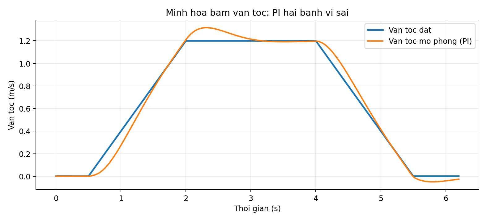

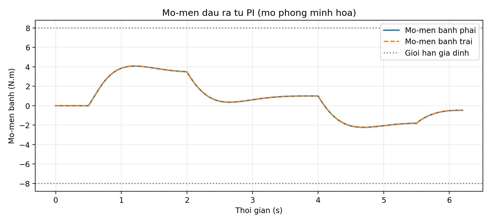

Đã chạy kiểm tra số: động học thuận/nghịch cho ra lại $(v,\omega)$ đã đặt; mô hình tốc độ duy trì trung bình khoảng **1,196 m/s** trong đoạn giữ lệnh 1,2 m/s; đầu ra mô-men không vượt ngưỡng bão hòa **giả định** 8 N·m. Kết quả này chỉ chứng minh script hoạt động theo mô hình đơn giản, **không chứng minh** yêu cầu khách hàng đã đạt, đặc biệt là sai số docking, an toàn tránh người, quãng đường thực và thời gian pin 4 giờ.

## 4.5. Đồ thị mô phỏng số mở rộng và dữ liệu tái lập

Ngoài bài thử tăng tốc–giữ tốc–giảm tốc ở §4.4, nhóm bổ sung một loạt kịch bản minh họa **khác** trong script [`../examples/simulate_extended_plots.py`](../examples/simulate_extended_plots.py): đi thẳng rồi vào cua, quay tại chỗ, so sánh P với PI dưới nhiễu tải giả định, và điều hướng đến bốn tọa độ giả định A→B→C→D. Kết quả có dữ liệu CSV đi kèm; tham số, giới hạn, ngưỡng đạt được ghi đầy đủ trong [`03_bieu_do_mo_phong_mo_rong.md`](03_bieu_do_mo_phong_mo_rong.md).

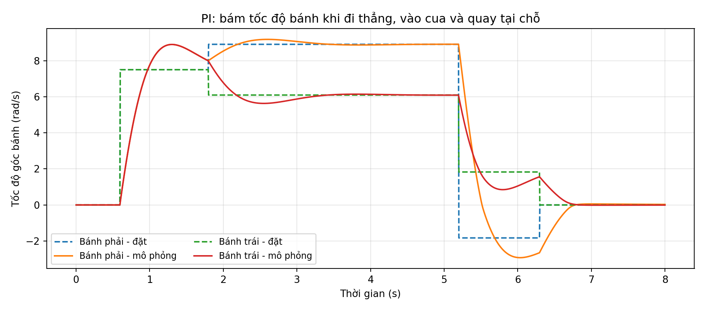

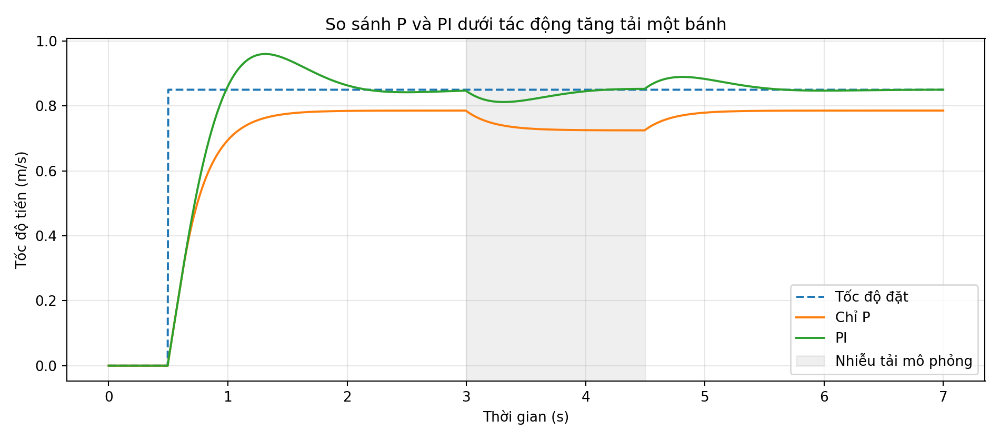

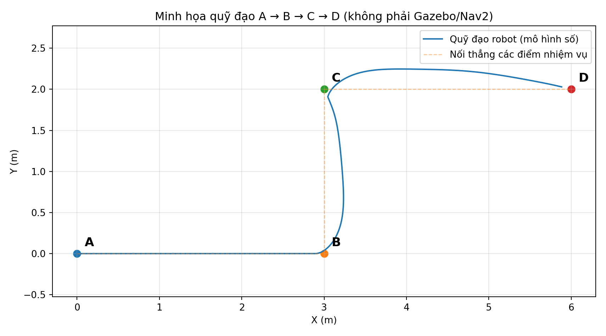

Các biểu đồ mới **không đo trên Gazebo, Nav2 hay robot thật**. Bộ điều khiển đi theo waypoint là phương pháp kiểm tra động học ở mức số, không phải chứng minh hệ robot đã chạy trong nhà máy. Chuyển waypoint khi khoảng cách còn < 0,12 m chỉ là ngưỡng mô phỏng, **không phải** minh chứng đạt sai số dừng 30 mm.

# 5. Áp dụng vào ROS 2 Jazzy, Gazebo và mô hình URDF của nhóm

## 5.1. Các tham số phải kiểm tra thống nhất

| Phần | Tệp hoặc dữ liệu cần đối chiếu | Lỗi phổ biến |
|:--|:--|:--|
| URDF/Xacro | `wheel_radius`, vị trí tâm bánh, joint axis, mass, inertia | Lấy bề rộng thân thay cho wheel separation |
| Gazebo DiffDrive | `<wheel_radius>`, `<wheel_separation>`, tên `left_joint/right_joint` | Sai dấu hoặc trùng tên joint |
| ros2_control | `wheel_radius`, `wheel_separation`, command/state interfaces | Hai node cùng điều khiển motor |
| Odometry/TF | `/odom`, `/tf`, `map → odom → base_link` | Nhiều publisher cùng phát odom→base_link |
| Sensor | Encoder, IMU, LiDAR và timestamp | Tốc độ encoder sai hệ số / đơn vị |
| PID driver | Đầu vào là PWM, dòng điện, mô-men hay vận tốc | Gán Kp/Ki từ mô hình torque sang PWM |

Với Gazebo Harmonic, cần kiểm tra plugin Gazebo hiện có đã điều khiển vận tốc bánh ở mức trừu tượng hay thật sự sử dụng mô hình mô-men/quán tính motor. Nếu chỉ là plugin DiffDrive nhận vận tốc, biểu đồ động lực và PI motor trong Python không thể được coi là bằng chứng Gazebo đã kiểm thử lực/mô-men. Nếu dùng `ros2_control` với interface vận tốc, bộ điều khiển vi sai có thể chỉ chuyển $v,\omega$ sang lệnh vận tốc joint; vòng PID thấp hơn có thể nằm trong driver hoặc trong một tầng khác.

## 5.2. Kịch bản kiểm thử nhóm nên chạy và lưu bằng chứng

| Mã | Kịch bản | Dữ liệu đầu ra phải lưu |
|:--|:--|:--|
| KT-01 | Hai bánh tốc độ bằng nhau → đi thẳng | `/cmd_vel`, `/odom`, `/joint_states`, đường đi |
| KT-02 | Hai bánh quay ngược chiều → quay tại chỗ | Sai lệch yaw, quỹ đạo, tốc độ bánh |
| KT-03 | Lệnh $(v,\omega)$ kết hợp → chạy cung tròn | Bán kính lý thuyết và thực nghiệm |
| PI-01 | Bám profile tốc độ khi không tải | Rise time, overshoot, sai số xác lập, torque/PWM |
| PI-02 | Bám profile với tải 20 kg | Tốc độ, dòng/mô-men, nhiệt độ, giới hạn |
| PI-03 | Thử mất lệnh / phản hồi encoder lỗi | Log sự kiện và hành vi an toàn |
| SYS-01 | Nhiệm vụ A → B → C → D | Thời gian, kết quả từng waypoint, nhật ký Nav2 |
| SYS-02 | Dừng tại trạm | Sai số x-y-yaw đo theo mốc đã chốt |

**Điều kiện nghiệm thu chưa đầy đủ:** tốc độ 1,2 m/s phải được kiểm tra dưới điều kiện thử được duyệt; sai số dừng $<30$ mm cần mốc đo và nhiều lần lặp; an toàn người/vật cản không thể kết luận chỉ từ PID; thời gian pin 4 giờ cần thử theo duty cycle thực tế. Các chức năng an toàn phải được đánh giá và kiểm chứng riêng.

## 5.3. Phân chia đầu việc để nhập tài liệu vào dự án

Tài liệu được lưu tại `research/diff_drive_pid/docs/` trong repository nhóm. Khi nhận được mã nguồn/ảnh Gazebo thật của nhóm, bổ sung ảnh tại `docs/control/assets/` và thay các giả định bằng số đọc được từ URDF, cấu hình controller, CAD và log. Gắn commit/tag và dẫn nguồn đến đúng tệp thay vì dán ảnh không có xuất xứ. Không đưa kết quả demo Python vào mục “Kết quả Gazebo” nếu chưa chạy thật.

# 6. Kết quả mô phỏng số và phân tích đồ thị

## 6.1. Ma trận thí nghiệm và bằng chứng

Các đồ thị của chương này được tái tạo bằng **Python**, sử dụng đúng giả định tại Bảng thông số ở Chương 1 và có dữ liệu CSV/JSON đi kèm. Code MATLAB trong thư mục `matlab/` tái hiện những thí nghiệm tương đương nhưng **chưa được chạy trong MATLAB tại thời điểm xuất tài liệu**. Vì vậy ảnh `extended_*.png` và `python_*.png` không được ghi là ảnh kết quả MATLAB, Gazebo hoặc robot thật.

| Nhóm thử nghiệm | Hình trong báo cáo | Đại lượng đánh giá |
|:--|:--|:--|
| Tăng tốc, giữ và giảm tốc | Tốc độ và mô-men | Sai số tốc độ, giới hạn |
| Đi thẳng, rẽ cong, quay tại chỗ | Vận tốc thân và hai bánh | Bám lệnh và quỹ đạo |
| Sai số và quỹ đạo | Sai số hai bánh, đường XY | Quá độ và sai lệch |
| Nhiễu tải | Đường đáp ứng P/PI | Phản ứng khi tăng tải |
| A–B–C–D minh họa | Quỹ đạo và khoảng cách trạm | Thời gian chuyển điểm |
| PI/PID lọc đạo hàm | Tốc độ và mô-men | Ảnh hưởng D và bão hòa |

## 6.2. Đi thẳng, rẽ cong và quay tại chỗ

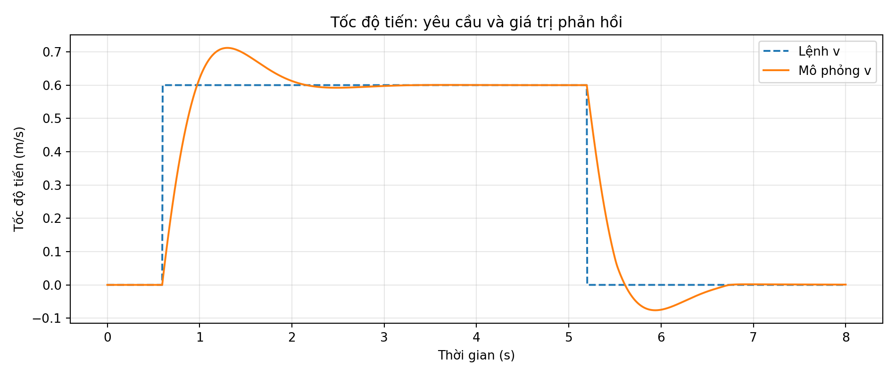

Vận tốc tiến đặt có các khoảng giữ lệnh 0,60 m/s và khoảng về 0 khi quay tại chỗ; vận tốc thực phản ứng trễ do quán tính và giới hạn mô-men. Đây là kết quả mô hình đơn giản trên nền phẳng, không có vật cản.

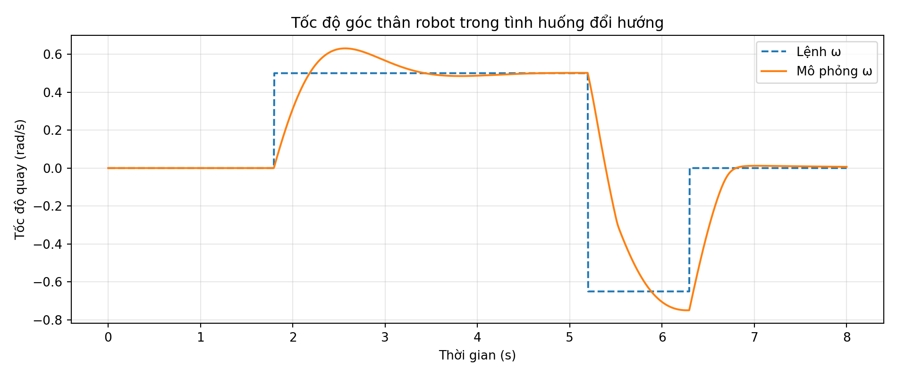

Ở đoạn quay trong hành lang, lệnh quay thân được quy đổi thành chênh lệch tốc độ hai bánh. Đường phản hồi không trùng hoàn toàn với lệnh vì vòng PI và quán tính tương đương. Chưa có kiểm chứng góc quay trên Gazebo.

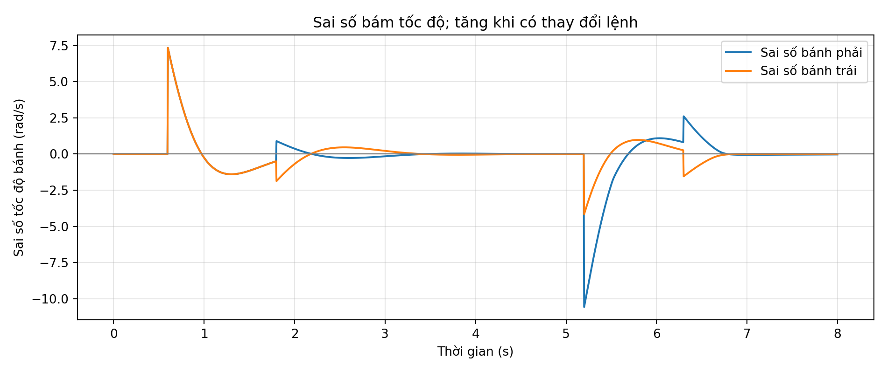

Sai số lớn nhất thường xuất hiện ngay sau khi đặt lệnh thay đổi nhanh. Cần kiểm tra cả sai số xác lập và quá độ; chỉ nhìn đường vận tốc tiến không đủ để đánh giá hai vòng điều khiển bánh có cân bằng nhau hay không.

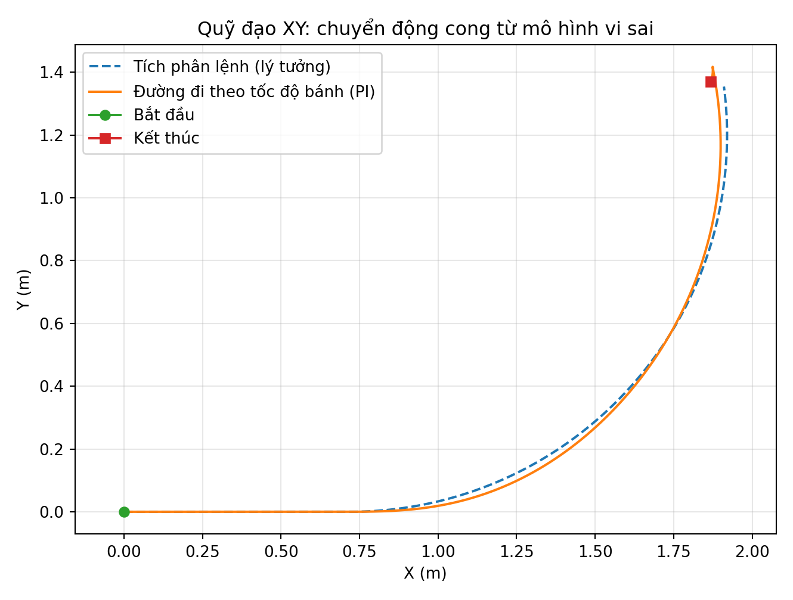

Sự lệch quỹ đạo giữa tích phân lệnh và tích phân vận tốc bánh mô phỏng phản ánh hạn chế của vòng điều tốc khi lệnh thay đổi. Muốn đánh giá chính xác cần có thông số bánh, khối lượng, quán tính và bản đồ kho thật.

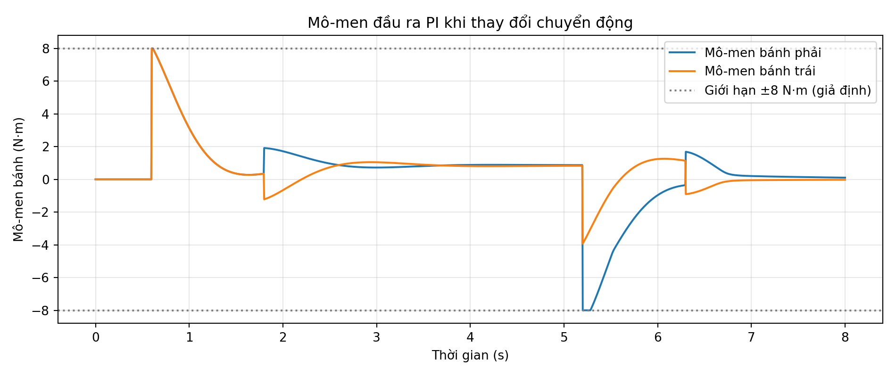

Mô-men được giới hạn trong ±8 N·m **theo giả định của mô hình**, không phải trị số liên tục/đỉnh của động cơ đã được mua. Với tỷ số truyền và hiệu suất đã giả định, giá trị mô-men tại bánh phải được quy đổi mới dùng để so sánh datasheet motor.

## 6.3. So sánh P và PI khi có nhiễu tải


Thí nghiệm tạo mô-men tải phụ 1,7 N·m tại bánh trái từ 3,0 đến 4,5 s. Theo mô hình này, khâu I giúp giảm sai số kéo dài so với chỉ P nhưng có thể tạo dao động hoặc quá độ khi nhiễu kết thúc. Đây không phải bằng chứng bộ PI phù hợp nhất với robot thực mà chỉ là cách minh họa cơ chế điều khiển.

## 6.4. So sánh PI và PID có đạo hàm lọc

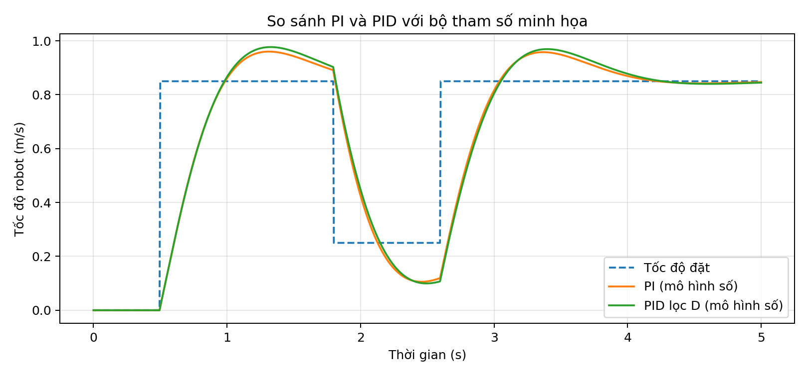

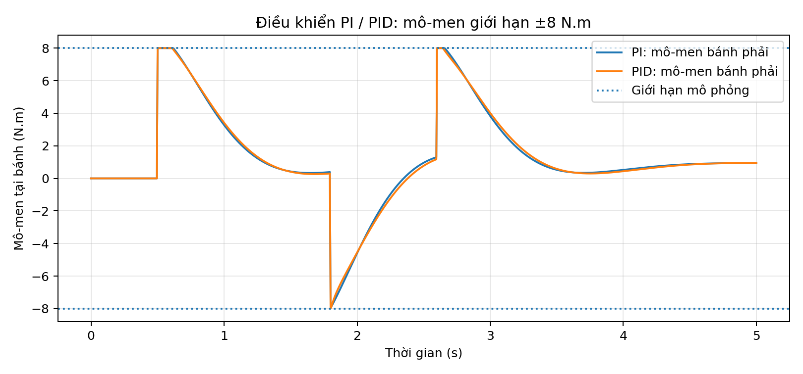

Cấu trúc PID sử dụng **đạo hàm của tốc độ đo** qua bộ lọc bậc nhất, tránh xung đạo hàm khi thay đổi tốc độ đặt. Dùng $K_p=1{,}1$, $K_i=3{,}0$, $K_d=0{,}02$ và hằng số lọc $0{,}04$ s trong ví dụ; tất cả là hệ số **minh họa**. Trên toàn đoạn có lệnh khác 0, chương trình đối chiếu Python cho RMSE tốc độ PI khoảng **0,211 m/s**, còn PID khoảng **0,217 m/s**. Bộ PID này **không cải thiện RMSE so với PI**, minh họa vì sao không thể khẳng định thêm thành phần D là tốt hơn nếu chưa hiệu chỉnh.

## 6.5. Mô phỏng nhiệm vụ A → B → C → D


Tọa độ được chọn để kiểm tra thuật toán trên mặt phẳng, không lấy từ sơ đồ nhà máy:

| Điểm | $x$ (m) | $y$ (m) |
|:--|--:|--:|
| A | 0 | 0 |
| B | 3 | 0 |
| C | 3 | 2 |
| D | 6 | 2 |

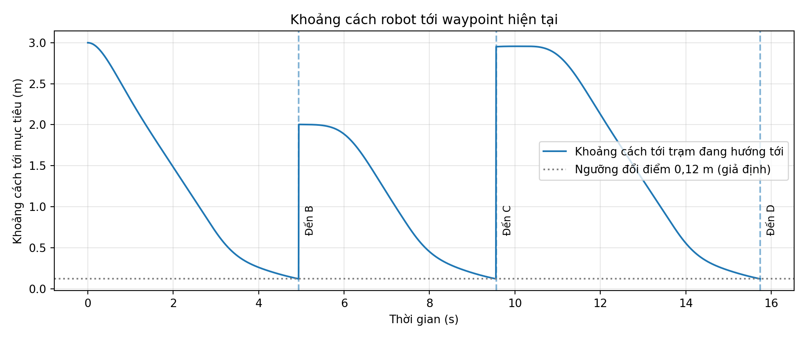

Thời điểm chuyển điểm trong lần chạy Python mẫu: B tại **4,94 s**, C tại **9,56 s** và D tại **15,745 s**. Ngưỡng kích hoạt chuyển điểm là $0,12$ m tức 120 mm, **không đạt và cũng không dùng để chứng minh tiêu chí dừng nhỏ hơn 30 mm**. Bộ điều khiển waypoint này không tích hợp SLAM/Nav2, vật cản hay an toàn người đi bộ.

## 6.6. Tình trạng kiểm chứng

| Hạng mục | Kết luận ở phiên bản tài liệu này |
|:--|:--|
| Phương trình động học và quy đổi hai bánh | Đã kiểm tra bằng các bài thử số Python |
| Chương trình Python và dữ liệu CSV | Đã chạy, có thể tái tạo lại hình |
| Mô hình MATLAB `.m` | Đã rà soát tĩnh; chưa kiểm chứng runtime MATLAB |
| Gazebo / ROS 2 / Nav2 | Chưa chạy kiểm tra trong lần cập nhật này |
| Động cơ 48 V - 250 W, hộp số, pin | Chỉ là phương án sơ bộ, chưa đối chiếu datasheet/URDF |
| Dừng chính xác dưới 30 mm và an toàn với người | Chưa có bằng chứng nghiệm thu |

# 7. Bộ mã MATLAB và quy trình tái lập

## 7.1. Cấu trúc và chức năng

Tất cả mã MATLAB được đặt dưới `research/diff_drive_pid/matlab/`. Bộ mã bao gồm **16 file `.m`**, có chức năng mô hình hóa động học thuận/nghịch, mô phỏng phương trình quán tính ghép hai bánh, chạy các bộ P/PI/PID và lưu ảnh, dữ liệu thô. Không yêu cầu Simulink hoặc Control System Toolbox trong luồng `run_all`. Nhóm có thể mở rộng lên Simulink sau khi đồng bộ với URDF và hệ điều khiển thật.

| Nhóm mã | File MATLAB chính | Vai trò |
|:--|:--|:--|
| Hằng số và động học | `amr_params.m`, `diffdrive_forward.m`, `diffdrive_inverse.m` | Thông số, động học bánh và thân |
| Vòng điều khiển | `wheel_pi_step.m`, `wheel_pid_step.m` | PI có anti-windup, PID có lọc D |
| Kịch bản | `simulate_straight_pi.m`, `simulate_turning.m`, `simulate_p_vs_pi.m` | Đi thẳng, rẽ và nhiễu tải |
| Quỹ đạo & PID | `simulate_waypoints.m` | A–B–C–D |
| So sánh PI/PID | Mã mô phỏng PI/PID | Chạy với tham số minh họa |
| Xuất và kiểm tra | `amr_plot_all.m`, `amr_write_csv.m`, `amr_save_png.m`, `validate_amr.m` | Hình, CSV, smoke tests |
| Chạy toàn bộ | `run_all.m`, `plot_from_python_csv.m` | Điều phối và đọc dữ liệu đối chiếu |

File dùng trong dòng so sánh PI/PID là `simulate_pi_pid_comparison.m`.

## 7.2. Chạy toàn bộ trên MATLAB

Mở MATLAB, di chuyển đến thư mục `research/diff_drive_pid/matlab` trong bản clone GitHub của nhóm:

```matlab
cd('C:\Users\nghoa\Desktop\Industrial_AMR_Robot\research\diff_drive_pid\matlab')
run_all
```

Sau khi chạy thành công, chương trình dự kiến tạo **14 ảnh `matlab_*.png`** tại `docs/assets/` và **7 CSV `matlab_*.csv`** tại `examples/data/`. Các ảnh này được xuất từ MATLAB trên máy người thực hiện, **không nằm sẵn trong báo cáo này** vì máy biên soạn không có MATLAB. Không đổi tên ảnh `extended_*.png` thành `matlab_*.png` vì làm vậy sẽ sai nguồn chứng cứ.

Nếu `run_all` báo lỗi, ghi log MATLAB, phiên bản MATLAB và tệp `.m` gây lỗi; chỉ đưa ảnh MATLAB vào tài liệu sau khi kiểm tra kết quả trực tiếp. MATLAB `validate_amr.m` chỉ là smoke test tính nhất quán số, không phải thử nghiệm nghiệm thu khách hàng.

## 7.3. Chạy Python đối chiếu và cập nhật PDF

Tại thư mục `research/diff_drive_pid/`:

```powershell
python -m pip install numpy matplotlib
python examples/simulate_diff_drive_pi.py
python examples/simulate_extended_plots.py
python examples/simulate_pi_pid_comparison.py
```

Lệnh đầu tạo profile đi thẳng, lệnh hai tạo chín biểu đồ mở rộng và các CSV, lệnh ba tạo so sánh PI/PID bổ sung. Mỗi ảnh đều có một script tái lập và được lưu trong `docs/assets/`. Chương trình không sử dụng mô hình kho Gazebo hoặc dữ liệu từ robot thật.

## 7.4. Đối chiếu với robot thật và bài thử tiếp theo

Trước khi đưa PID lên controller của robot, cần kiểm tra cấu hình URDF hiện hành (`wheel_radius`, `wheel_separation`, khối lượng, mô-men quán tính), tỷ số truyền và driver, chu kỳ điều khiển thực, dấu encoder và phương án chống mất lệnh. Nếu driver đã tự điều tốc bằng FOC/PID, không tạo hai vòng tốc độ xung đột. Để nghiệm thu, cần log ROS 2/Gazebo hoặc robot thật với nguồn dữ liệu và thời gian cụ thể; đặc biệt phải có bài test độ chính xác docking, khả năng phanh và khả năng vận hành dưới tải.

# 8. Kết luận

Báo cáo đã tổng hợp cơ sở động học, động lực học và PID của robot AMR truyền động vi sai, có mô hình quán tính ghép hai bánh, tính chọn sơ bộ lực kéo–mô-men, phương pháp mô phỏng và phân tích hình ảnh. Bộ mã MATLAB 16 tệp, bộ mã Python và dữ liệu CSV được sắp xếp chung trong cùng thư mục để nhóm sử dụng khi viết báo cáo và làm slide.

Kết quả chạy Python cho thấy mô hình số có thể tái hiện các chuyển động đi thẳng, vào cua, quay tại chỗ, phản ứng P/PI/PID khi tải thay đổi và nhiệm vụ waypoint A–B–C–D minh họa. Các số liệu này **không xác nhận** hiệu năng, an toàn hoặc độ chính xác của AMR do nhóm chế tạo. Giai đoạn tiếp theo cần chạy `run_all.m` trên MATLAB của thành viên, so khớp với URDF và kiểm chứng Gazebo/ROS 2 bằng ảnh, log và kịch bản thử nghiệm thực tế.

# Tài liệu tham khảo

1. ROS 2 Control: [diff_drive_controller (Jazzy)](https://control.ros.org/jazzy/doc/ros2_controllers/diff_drive_controller/doc/userdoc.html).
2. ROS 2 Documentation: [About tf2](https://docs.ros.org/en/jazzy/Concepts/Intermediate/About-Tf2.html).
3. Gazebo: [Gazebo Harmonic documentation](https://gazebosim.org/docs/harmonic/).
4. Repository nhóm: [Industrial_AMR_Robot](https://github.com/HoangAnh301194/Industrial_AMR_Robot) (thông số động lực học phải được kiểm tra với cấu hình phiên bản hiện hành).

