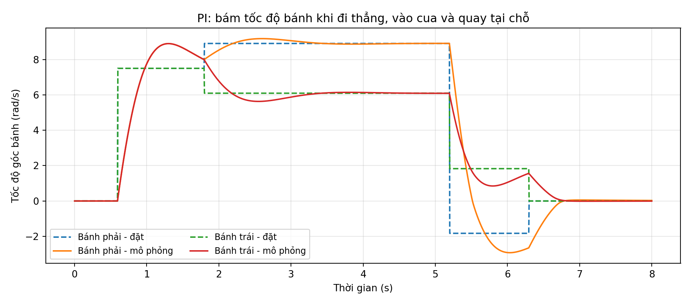
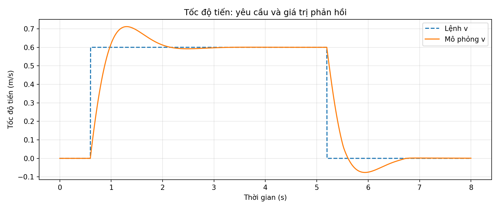
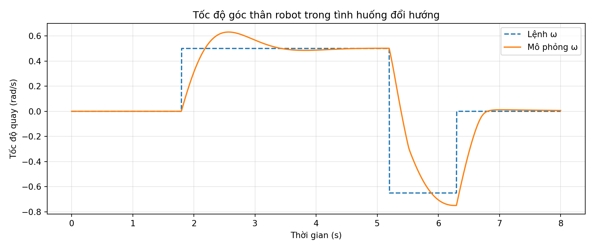
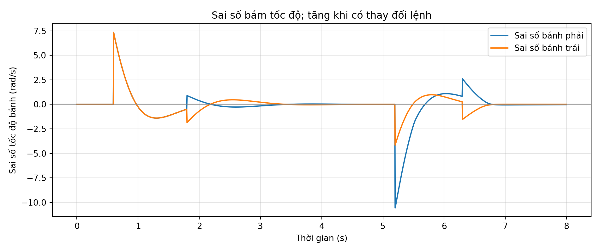
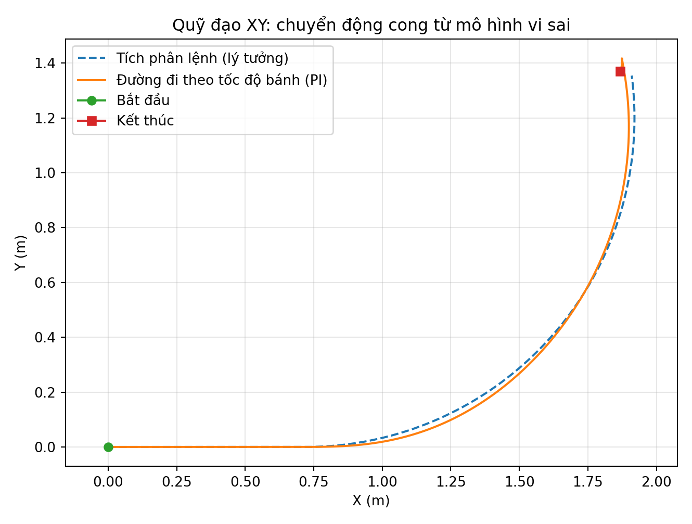
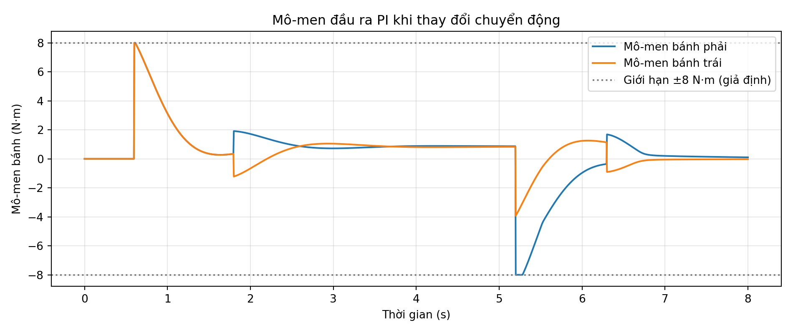
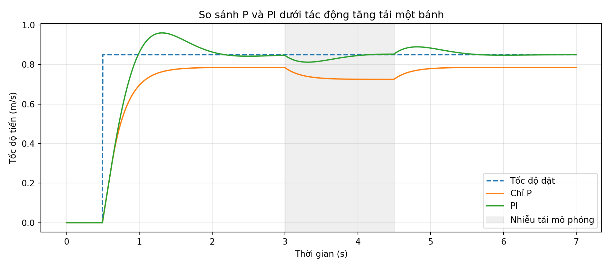
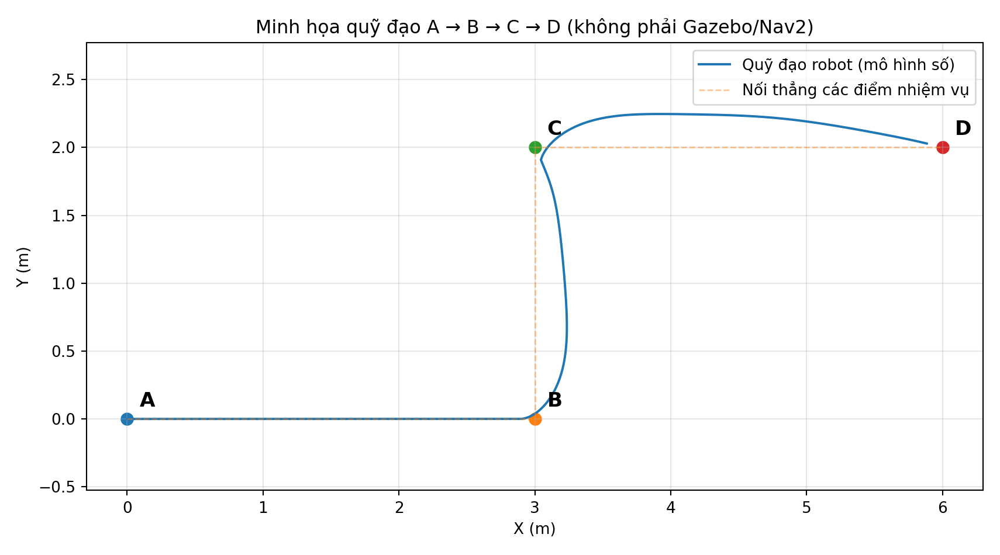
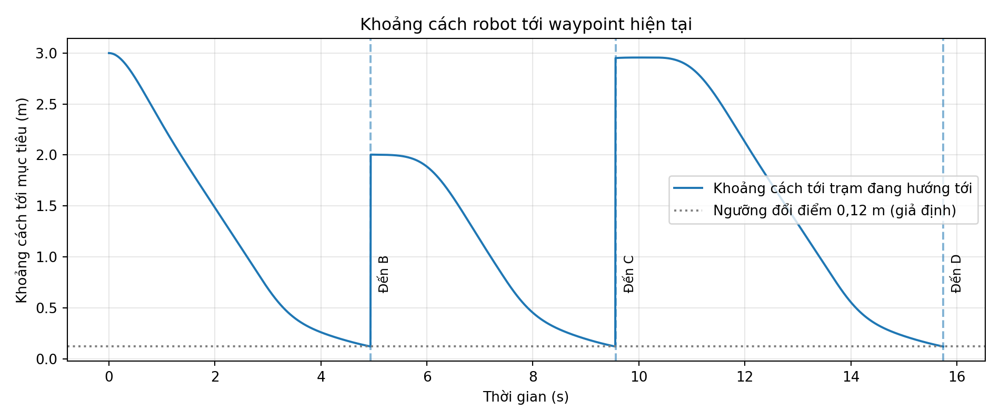

# Bộ ảnh và đồ thị mô phỏng số bổ sung – robot vi sai hai bánh

**Loại bằng chứng:** Python/Numpy mô hình động học–động lực học giản lược. Đây **không phải** kết quả Gazebo, ROS 2 Nav2, robot thật, thử nghiệm an toàn hay xác nhận PID đã hiệu chỉnh.

## 1. Phạm vi và thông số dùng trong ví dụ

| Thông số | Giá trị | Loại dữ liệu |
|---|---:|---|
| Tổng khối lượng | 75 kg | Giả định (robot 55 kg + tải 20 kg) |
| Bán kính bánh chủ động | 0,08 m | Giả định thiết kế |
| Khoảng cách tâm hai bánh | 0,45 m | Giả định thiết kế |
| Cản lăn | 0,025 | Giả định |
| Quán tính mỗi bánh | 0,012 kg·m² | Giả định |
| PI ở mức mô-men bánh | Kp = 1,1; Ki = 3,0 | Giá trị minh họa, không dùng thật |
| Mô-men giới hạn | ±8 N·m/bánh | Giới hạn mô phỏng, không phải datasheet |
| Bước mô phỏng | 0,005 s | Cấu hình số |

Từ cùng một mô hình có hai bánh, điều khiển PI độc lập cho mỗi bánh và tích phân tư thế. Mô phỏng quỹ đạo A–B–C–D có thêm một vòng điều khiển vị trí đơn giản sinh ra lệnh v, ω. Không xét vật cản, bản đồ, mất định vị, độ trễ truyền thông, va chạm hay nhiễu encoder thực tế.

## 2. Chế độ đi thẳng – vào cua – quay tại chỗ

### Hình 1. Tốc độ góc hai bánh: lệnh và phản hồi



Đo sự sai khác của tốc độ góc bánh thực mô phỏng với lệnh chuyển động tính từ động học nghịch. Khi chuyển từ đi thẳng sang rẽ, hai bánh xuất hiện hai tốc độ đặt khác nhau, sau đó bộ PI bù lại.

### Hình 2. Vận tốc tiến của thân robot



Lệnh mẫu 0,60 m/s được sử dụng để tách rõ các giai đoạn tăng, giữ và giảm tốc. Đây **không phải** bài kiểm tra khả năng đạt 1,2 m/s; bài thử 1,2 m/s đã có ở tài liệu gốc.

### Hình 3. Tốc độ quay thân robot



Đo khả năng theo lệnh quay khi robot đổi hướng và quay tại chỗ; đơn vị rad/s.

### Hình 4. Sai số tốc độ hai bánh



Các đỉnh sai số xuất hiện khi đổi lệnh đột ngột. Cần đánh giá thêm với giới hạn gia tốc/jerk thực tế trước khi triển khai.

### Hình 5. Quỹ đạo XY khi vào cua



Đường đứt nét lấy từ tích phân lệnh lý tưởng; đường liền lấy từ tốc độ bánh thực mô phỏng. Hai đường không hoàn toàn trùng nhau do thời gian quá độ của bộ PI.

### Hình 6. Mô-men hai bánh



Biểu đồ có giới hạn ±8 N·m chỉ để quan sát bão hòa trong mô hình; không thể thay biểu đồ đặc tính mô-men–tốc độ motor thật.

## 3. So sánh P và PI khi tải thay đổi

### Hình 7. Tốc độ tiến dưới nhiễu tải giả định



Trong cửa sổ 3–4,5 s, bổ sung mô-men tải phụ 1,7 N·m ở bánh trái. Bộ điều khiển chỉ P để lại sai số tốc độ, còn PI khắc phục sai số xác lập tốt hơn nhưng có độ vọt lố và quá độ. Đây chỉ là minh họa đặc tính điều khiển, không phải kết luận PI tối ưu trong mọi trường hợp.

## 4. Minh họa quỹ đạo A → B → C → D

Tọa độ 2D là ví dụ tự đặt, **không phải tọa độ kho A/B/C/D thật**:

| Trạm | X (m) | Y (m) |
|---|---:|---:|
| A | 0 | 0 |
| B | 3 | 0 |
| C | 3 | 2 |
| D | 6 | 2 |

### Hình 8. Đường đi trong mô hình số



Một bộ điều khiển vị trí P đơn giản sinh lệnh vận tốc tiến và quay, qua động học nghịch và bộ PI hai bánh để tạo chuyển động. Các sự kiện chuyển điểm xảy ra khoảng 4,94 s (B), 9,56 s (C), 15,745 s (D). Không có chức năng tránh vật cản; KHÔNG được giới thiệu là kết quả Nav2.

### Hình 9. Khoảng cách tới waypoint hiện tại



Khi khoảng cách < 0,12 m, mô hình đổi sang trạm tiếp theo. Đặt ngưỡng 120 mm để minh họa logic waypoint **không đồng nghĩa robot đạt yêu cầu sai số dừng < 30 mm**. Để đánh giá 30 mm cần điều khiển docking, xác định mốc đo, lặp lại và thu dữ liệu thực tế.

## 5. Tái lập, phân loại và kiểm tra

Chạy trong thư mục `research/diff_drive_pid`: 

```bash
python3 -m pip install numpy matplotlib
python3 examples/simulate_diff_drive_pi.py
python3 examples/simulate_extended_plots.py
```

Tệp ảnh được tạo vào `docs/assets/extended_*.png`. Dữ liệu số được xuất ra:

- `examples/data/turning_scenario.csv` – vận tốc thân, lệnh và phản hồi bánh, mô-men, pose.
- `examples/data/compare_p.csv` và `compare_pi.csv` – dữ liệu đánh giá tải phụ.
- `examples/data/waypoint_scenario.csv` – pose và goal đang hoạt động.
- `examples/data/simulation_summary.json` – toàn bộ giả định và sự kiện đi qua các điểm.

Kịch bản này chỉ chứng minh rằng mô hình số có thể chạy và cho đồ thị bám lệnh, không đại diện khả năng hoàn thành vận chuyển tải 20 kg trong thực tế. Để chuyển thành bằng chứng của nhóm, cần các ảnh và log Gazebo/RViz2/ROS 2 thực tế: `scan`, `odom`, `tf`, `/joint_states`, trạng thái Nav2, tọa độ điểm A/B/C/D và kết quả docking.
